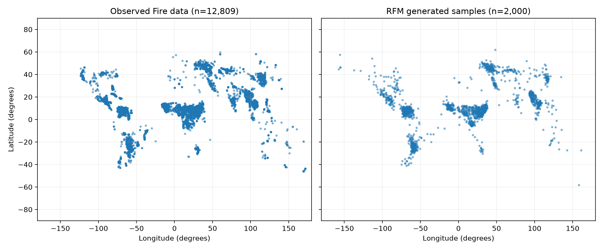

# gdl-papers

Geometric deep learning builds neural networks that respect the structure and
symmetries of their data. **Symmetries are transformations that preserve the
underlying meaning or physics**: rotating or translating a molecule does not
change its energy, and relabeling its atoms does not make it a different molecule.
A model should preserve these relationships—for example, predicted energy stays
unchanged under rotation, while predicted forces rotate with the molecule.

I studied 16 papers and foundational texts alongside Timothy Nguyen's
differential geometry lectures, and selected three papers for deeper study and
implementation: **EGNN, Riemannian Flow Matching, and MACE**.
Together, they explore three uses of geometry: predicting properties, generating
data on curved spaces, and modeling atomic interactions.

- **EGNN** predicts molecular properties using messages between atoms, with
  distances supplying information about molecular geometry.
- **Riemannian Flow Matching** learns to transport a simple distribution into a
  data distribution on a curved space, demonstrated here with geographic
  locations on a sphere.
- **MACE** combines geometric features through higher-order interactions to
  predict molecular energies and atomic forces.

This repository connects each paper's equations to a PyTorch implementation,
with training and evaluation code, tests, learning walkthroughs, and comparisons
against published results.



RFM run `20260818-103835`: all 12,809 observed Fire locations alongside 2,000
generated samples. This saved-run visualization illustrates the learned spatial
distribution; it is not a held-out evaluation or a claim of paper-level accuracy.

## Results

Measured results below use held-out data. Lower is better; experimental scope
and comparison limits are listed after the tables.
The trained checkpoints behind these results are published in the
[`checkpoints-v1` release](https://github.com/mettafore/gdl-papers/releases/tag/checkpoints-v1) with SHA-256 checksums; each paper
README's "Verify" section gives the download and evaluation commands.

| Paper | Task | Metric | Paper | This repo |
|---|---|---|---:|---:|
| [EGNN](papers/01-EGNN/) | QM9 HOMO–LUMO gap | MAE (meV) | 48 | **[48.50](papers/01-EGNN/README.md#results)** |
| [Riemannian Flow Matching](papers/14-RFM/) | Fire locations on S² | Test NLL (uniform-sphere baseline: +2.531) | −1.86 ± 0.11 | **[−0.7004](papers/14-RFM/results/local-evaluation-20261013.json)** |
| [MACE](papers/15-MACE/) | 3BPA, 300 K | Energy RMSE (meV) | 3.0 | **[3.99](papers/15-MACE/results/holdout-seed123-epoch360.json)** |
| | | Force RMSE (meV/Å) | 8.8 | **[11.56](papers/15-MACE/results/holdout-seed123-epoch360.json)** |

**MACE, all 3BPA test sets** (epoch-360 checkpoint, single seed; paper values are three-seed means):

| Test set | Energy RMSE (meV) | Paper | Force RMSE (meV/Å) | Paper |
|---|---:|---:|---:|---:|
| 300 K | [3.99](papers/15-MACE/results/holdout-seed123-epoch360.json) | 3.0 | [11.56](papers/15-MACE/results/holdout-seed123-epoch360.json) | 8.8 |
| 600 K | [13.28](papers/15-MACE/results/holdout-seed123-epoch360.json) | 9.7 | [28.96](papers/15-MACE/results/holdout-seed123-epoch360.json) | 21.8 |
| 1200 K | [44.51](papers/15-MACE/results/holdout-seed123-epoch360.json) | 29.8 | [96.01](papers/15-MACE/results/holdout-seed123-epoch360.json) | 62.0 |
| Dihedral slices | [17.57](papers/15-MACE/results/holdout-seed123-epoch360.json) | 7.8 | [21.15](papers/15-MACE/results/holdout-seed123-epoch360.json) | 16.5 |

## Scope and limitations

- EGNN: one QM9 target and checkpoint, using a lower-learning-rate warm start;
  this is not a full multi-target reproduction.
- RFM: local evaluation of run `20260818-103835`, seed 42, confirms test NLL
  −0.7004 on 1,282 held-out points with adaptive `dopri5` and `1e-7` tolerances.
  It improves on uniform +2.531 but does not match the paper's five-run mean
  −1.86 ± 0.11. Training budget and recipe differ.
- MACE: one seed, trained for 367 of 500 planned epochs due to compute limits.
  Results use the best-validation EMA checkpoint at epoch 360. Errors are higher
  than the paper's three-run averages; next steps are learning-curve analysis and
  additional seeds.

## Explore the implementations

| Paper | Code | Explanation |
|---|---|---|
| EGNN | [Model](papers/01-EGNN/src/model.py) | [Walkthrough](papers/01-EGNN/learning-notes.md) |
| RFM | [Geometry](papers/14-RFM/src/geometry.py), [model](papers/14-RFM/src/model.py) | [Walkthrough](papers/14-RFM/learning-notes.md) |
| MACE | [Model](papers/15-MACE/src/model.py) | [Walkthrough](papers/15-MACE/learning-notes.md) |

Each paper README documents its data, commands, and configuration. Papers stay
independent; `src/gdl/` contains only shared run, checkpoint, logging, and metric
helpers. [Progress](docs/progress.md) records experiments and remaining work.

## Papers and lectures studied

My study covered mathematical foundations, molecular graph networks, equivariant
architectures, and generative modelling. I worked through the mechanisms and
mathematics of the resources below, then selected **EGNN, Riemannian Flow Matching,
and MACE** for implementation and evaluation. The results and their experimental
scope are documented above.

| Paper or lecture series | Main ideas studied | Work completed |
|---|---|---|
| [Mathematical Foundations of Geometric Deep Learning — Borde & Bronstein](https://arxiv.org/abs/2508.02723) | Vector calculus, topology, differential geometry, functional analysis, spectral theory and graph theory | Studied |
| [Geometric Deep Learning: Grids, Groups, Graphs, Geodesics, and Gauges — Bronstein et al.](https://arxiv.org/abs/2104.13478) | Symmetry, invariance, equivariance and a geometric blueprint for neural architectures | Studied |
| [Differential Geometry Lectures 1–5 — Timothy Nguyen (YouTube)](https://www.youtube.com/playlist?list=PL0uWtVBhzF5Arw8NfB7-1jG-mfVClb8sH) | Gauge theory, parallel transport, tangent/cotangent vectors, exterior algebra, differential forms and Stokes' theorem | Watched lectures 1–5; study notes |
| [Hitchhiker's Guide to Geometric GNNs](https://arxiv.org/abs/2312.07511) | Geometric representations and the equivariant GNN landscape | Studied |
| [Neural Message Passing for Quantum Chemistry (MPNN)](https://arxiv.org/abs/1704.01212) | Message passing for molecular property prediction | Studied |
| [SchNet](https://arxiv.org/abs/1706.08566) | Continuous filters based on interatomic distances | Studied |
| [Tensor Field Networks (TFN)](https://arxiv.org/abs/1802.08219) | Spherical harmonics and equivariant tensor features | Studied |
| [SE(3)-Transformer](https://arxiv.org/abs/2006.10503) | Equivariant attention | Studied |
| [Equiformer](https://arxiv.org/abs/2206.11990) | Transformers built from equivariant operations | Studied |
| [NequIP](https://arxiv.org/abs/2101.03164) | Equivariant message passing for interatomic potentials | Studied |
| [**E(n)-Equivariant Graph Neural Networks (EGNN)**](https://arxiv.org/abs/2102.09844) | Equivariance through distances and coordinate updates | **Implemented and evaluated on QM9**; [walkthrough](papers/01-EGNN/learning-notes.md) |
| [Denoising Diffusion Probabilistic Models (DDPM)](https://arxiv.org/abs/2006.11239) | Denoising objectives and diffusion sampling | Studied |
| [Score-Based Generative Modeling through SDEs](https://arxiv.org/abs/2011.13456) | Score matching, reverse-time SDEs, and probability-flow ODEs | Studied |
| [Flow Matching](https://arxiv.org/abs/2210.02747) | Learning vector fields through conditional probability paths | Studied |
| [ManifoldFormer](https://arxiv.org/abs/2511.16828) | Riemannian representations and geodesic attention for EEG | Studied |
| [**Riemannian Flow Matching**](https://arxiv.org/abs/2302.03660) | Flow matching on manifolds and premetric-based paths | **Implemented and evaluated on spherical Fire data**; [walkthrough](papers/14-RFM/learning-notes.md) |
| [**MACE**](https://arxiv.org/abs/2206.07697) | Higher-order equivariant interactions for molecular energies and forces | **Implemented and evaluated on 3BPA; three-seed benchmark incomplete**; [walkthrough](papers/15-MACE/learning-notes.md) |
| [BLIPs: Bayesian Learned Interatomic Potentials](https://arxiv.org/abs/2508.14022) | Uncertainty quantification for interatomic potentials via variational adaptive dropout; local reparameterisation and its equivariance limits | Studied |

## Quickstart

```bash
uv sync                                               # install deps + the gdl package

# train with defaults
uv run python papers/00-template/src/train.py             # prints a run_id

# train with hyperparameter overrides
uv run python papers/00-template/src/train.py --lr 1e-3 --epochs 50 --hidden 32

# evaluate a specific run
uv run python papers/00-template/src/evaluate.py --run <run_id>

# tests
uv run pytest papers/00-template/
```

## Commit checks

Enable the versioned Git hook once per clone:

```bash
git config core.hooksPath .githooks
```

It blocks commits that add a file over 1 MB or contain a secret, and commits
where Ruff formatting and linting, per-paper type checks, or the lightweight test
suites fail. Dataset-backed tests remain opt-in.

The secret scan needs [gitleaks](https://github.com/gitleaks/gitleaks) on your
`PATH` (`brew install gitleaks`); without it the hook warns and skips that step.
CI runs the same checks, and its gitleaks scan covers the full history.

## License

Original repository code and documentation use the [MIT license](LICENSE).
Third-party source, research papers, and datasets retain their own terms; see
[Third-party notices](THIRD_PARTY_NOTICES.md).

## Layout

- `src/gdl/` — shared, paper-agnostic helpers (seed, metrics, logging, run, checkpoint)
- `papers/NN-name/` — one paper each (model, data, train, evaluate, README, runs/)
- `papers/00-template/` — the runnable template; copy it to start a new paper

## Learning from this repo

Each paper folder has its own README — what the paper does, how to run it, and the
expected results — so it works as a self-contained learning resource. New to
geometric deep learning? Start at `papers/00-template/` (the simplest), then read
each paper's README to follow the progression.

## AI operating surface

Built with **Claude Code**.

- **Rules** → [AGENTS.md](AGENTS.md)
- **Skills** → `.agents/skills/` — `run-paper` (run train/eval), `gdl-repo-map` (repo map)
- **MCP** → context7 (live library docs)

## Papers

**Status:** [docs/progress.md](docs/progress.md) — canonical tracker, update it when you
work on a paper.

Full list and tiers → [references/papers.md](references/papers.md).

## Running via skills (conversational)

In Claude Code, drive any paper in natural language — the `run-paper` skill maps it
to the commands above:

- "train 00-template" — train with defaults
- "train 00-template with lr 1e-3, 50 epochs" — overrides forwarded to CLI args
- "evaluate 00-template run <run_id>" — evaluate a run

Ask `gdl-repo-map` things like "where does shared code go?" or "how do I add a paper?"

## Automated PR review

- The Claude review workflow is configured for new or updated pull requests;
  successful live review remains unverified. Comment-triggered reviews require
  `@claude` on a pull request; ordinary issue comments do not start a review.
- Configure `CLAUDE_CODE_OAUTH_TOKEN` in GitHub repository secrets using the
  token produced by `claude setup-token`.
- The workflow grants the CLI access to PR viewing, diffs, and comments. It
  reports common authentication, usage-limit, or model-access failures with
  fixed diagnostic messages. Raw provider responses are not printed.
- Failed reviews remain failed. Local diagnostic tests do not prove that the
  configured Claude account can complete a live review. Setup details:
  [official action documentation](https://github.com/anthropics/claude-code-action/blob/main/docs/setup.md).
