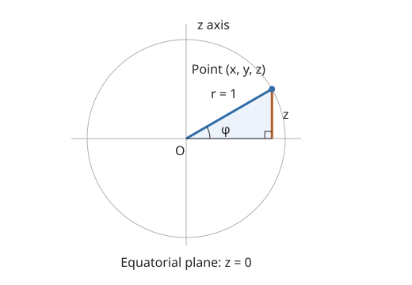

# RFM learning notes

## Quick recall

- **Data:** latitude/longitude → unit-sphere points `(n,3)`; seeded train/validation/test split.
- **Base:** uniform samples on S²; noise and data endpoints define a shortest geodesic.
- **Training position:** `xt = Exp_x0(t Log_x0(x1))`; construct directly without an ODE solve.
- **Target:** Eq. 13 gives the conditional velocity; on the sphere it simplifies to `Log_xt(x1)/(1-t)`.
- **Model:** position + time → ambient MLP velocity → tangent projection.
- **Loss:** mean squared tangent-velocity error; validation uses the same regression objective.
- **Generation:** integrate the learned field forward from uniform noise.
- **Density evaluation:** integrate held-out points backward with exact Jacobian traces; numerical ODE accuracy depends on tolerances.
- **Signs:** `NLL = log(4*pi) + mean(correction)`; uniform NLL is +2.531 and lower is better.
- **Evidence:** saved checkpoint NLL −0.7004; the local MLP and training recipe differ from the authors' benchmark.

## Revision navigation

| Section | Recall |
|---|---|
| [Data conversion](#datapy--cartesian-points-to-latitudelongitude) | Coordinates, units, and shapes |
| [Sphere geometry](#geometrypy--sampling-points-on-the-sphere) | Sampling, exp/log maps, and distance gradients |
| [FM refresher](#flow-matching-refresher--connecting-the-geometry-to-training) | Conditional clouds and gradient equivalence |
| [RFM equations](#rfm-equations--from-transported-density-to-a-conditional-velocity) | Distance schedule and Eq. 13 derivation |
| [Model](#modelpy--time-conditioned-tangent-velocity) | Ambient field and tangent projection |
| [Training](#trainpy--connecting-the-pieces) | Velocity targets, loss, and validation |
| [Evaluation](#evaluatepy--sampling-and-held-out-density) | Integration, divergence, and NLL signs |
| [Measured result](#saved-checkpoint-evaluation--13-october-2026) | Saved evaluation evidence and limitations |

## `data.py` — Cartesian points to latitude/longitude

Code: [`cartesian_to_latlon_degrees`](src/data.py).

We start with a tensor of shape `(n, 3)`. Each row contains the Cartesian coordinates `x`, `y`, and `z` of one point.

First we check the input: it must have two dimensions, three columns, at least one row, and only finite values. The finite-value check rejects the input if any entry is NaN or infinity.

Then `torch.linalg.vector_norm(points, dim=1, keepdim=True)` finds the norm of each row: `sqrt(x² + y² + z²)`. The result has shape `(n, 1)`. Keeping that dimension lets us divide every coordinate in a row by the same norm through broadcasting. We also reject zero vectors because they have no direction and cannot be normalized.

Dividing by the norm gives unit points of shape `(n, 3)` on the surface of the sphere. This preserves the direction of each nonzero point. I initially described this as taking arbitrary Cartesian points onto the sphere; that is mathematically correct, but the purpose here is to correct small numerical drift after ODE integration.

### Latitude

I initially said “latitude is the z-axis.” Correction: latitude is an angle, while `z` is a coordinate. Latitude is measured up or down from the equatorial plane.



Using the right triangle, sine is opposite over hypotenuse:

$$
\sin\phi = \frac{z}{r}.
$$

On the unit sphere, `r = 1`, so `sin φ = z`. We recover the latitude with `asin(z)` — arcsine, or inverse sine — and convert the angle from radians to degrees with `torch.rad2deg`. The clamp to `[-1, 1]` keeps the input within arcsine's domain despite floating-point rounding.

### Longitude

For longitude, we look around the horizontal circle made by the latitude. The `x` and `y` coordinates give the adjacent and opposite components of the angle in that plane.

I initially suggested using a dot product because the axes are orthogonal. Correction: this line does not use a dot product. It uses `atan2(y, x)`, which uses both coordinates and their signs to identify the correct quadrant. Plain `atan(y/x)` loses that quadrant information and requires division by `x`. We then convert the longitude from radians to degrees.

At an exact pole, `x = y = 0`, so longitude is geometrically undefined; the function still returns a numerical convention there.

### Return shape

Latitude and longitude each have shape `(n,)`. We stack them along `dim=1`, giving an output of shape `(n, 2)`. Each row is ordered `[latitude, longitude]`, in degrees.

## `data.py` — Latitude/longitude to Cartesian points

Code: [`latlon_degrees_to_cartesian`](src/data.py).

Our input contains latitude and longitude, with shape `(n, 2)`. We raise an error if the tensor does not have two dimensions or its second dimension does not have size 2. Latitude must lie between −90 and +90 degrees, and longitude between −180 and +180 degrees, including the endpoints. I initially missed the minus sign on the lower latitude bound.

We also check that all coordinate values are finite. I initially described this as checking whether the number of records is infinite; the check actually rejects NaN or infinity in the coordinates. If the dtype is not `torch.float32`, we do not raise an error: we convert it to `float32`.

This reverses the previous conversion. To get `z`, we first convert latitude from degrees to radians and then take its sine:

$$
\phi = \frac{\pi}{180}\,\text{latitude}, \qquad z = \sin\phi.
$$

I initially described this as assigning latitude to `z`. Correction: `z` is the sine of the latitude angle on the unit sphere, not the angle itself. We reshape `z` to `(n, 1)`.

Next we need the angle around the latitude circle, so we get `theta` from longitude and convert it from degrees to radians. It has shape `(n,)`.

We want the radius of the small horizontal circle at height `z`. From the same right triangle in the latitude figure, the sphere radius is the hypotenuse and `r` and `z` are the perpendicular sides:

$$
r^2 + z^2 = 1, \qquad r = \sqrt{1-z^2}.
$$

I initially said the radius was `1 - z²`; that is the squared radius, so we need the square root. Here `r` has shape `(n, 1)`.

Then we get `x = r cos(theta)` and `y = r sin(theta)`. We reshape the cosine and sine results to `(n, 1)` before multiplying by `r`, so each point's radius multiplies its own angle's result. Finally, `x`, `y`, and `z` all have shape `(n, 1)`, and concatenating them along `dim=1` returns unit-sphere Cartesian points of shape `(n, 3)`.

## `data.py` — Loading the Fire CSV

Code: [`load_fire_csv`](src/data.py).

We first read the CSV into a pandas DataFrame with shape `(n, 2)`, since each row contains latitude and longitude in degrees. Then `torch.tensor(data.values)` converts the DataFrame's values into a tensor, still with shape `(n, 2)`.

Finally, we pass that tensor to `latlon_degrees_to_cartesian`, which converts the latitude/longitude pairs into unit-sphere Cartesian coordinates `(x, y, z)`. The returned tensor has shape `(n, 3)`.

The full path is: DataFrame `(n, 2)` → latitude/longitude tensor `(n, 2)` → Cartesian tensor `(n, 3)`.

## `data.py` — Splitting points into train, validation, and test sets

Code: [`split_points`](src/data.py).

This function takes our Cartesian points tensor of shape `(n, 3)` and splits it into train, validation, and test sets. We supply a seed for reproducible shuffling and percentages for the three sets, defaulting to 80%, 10%, and 10%.

First we check the percentage values. I initially said we were checking the point values; these checks actually apply to `train_pct`, `val_pct`, and `test_pct`. They must be integers or floats, finite, and nonnegative. Booleans are explicitly rejected because Python treats them as integers. We also check that the percentages sum to 100 within the small tolerance used by `math.isclose`.

Then we create a `torch.Generator` and set its seed with `manual_seed(seed)`. I initially described this as generating a seed; it sets the supplied seed so that the same input order and seed reproduce the same shuffle.

We take `n` as the number of points and use `torch.randperm(n, generator=generator)` to produce shuffled row indices of shape `(n,)`. We calculate the train and validation counts from their percentages, using `int(...)` to round these nonnegative counts down. Test gets the remaining points: `n - n_train - n_val`. This keeps every row even when the percentage calculations produce fractional counts.

Indexing with `points[indices]` rearranges the rows, retaining shape `(n, 3)`. We then use `torch.split` with the three counts to split along the default dimension, `dim=0`. The returned tensors have shapes `(n_train, 3)`, `(n_val, 3)`, and `(n_test, 3)`.

Finally, we return all three sets: train, validation, and test. I initially said only train and test; validation is returned too.

## `geometry.py` — Sampling points on the sphere

Code: [`sample_sphere`](src/geometry.py).

The input `n` is not a collection of points; it is the number of points we want to sample. The optional `device` selects where the tensors are created. If `n` is less than or equal to zero, we raise a `ValueError`.

We first sample heights `z`. `torch.rand(n, 1)` gives values in `[0, 1)`, and multiplying by 2 and subtracting 1 puts them in `[-1, 1)`. The shape is `(n, 1)`.

Wherever a height `z` falls, a horizontal slice through the sphere forms a smaller latitude circle. I initially said its radius was `1 - z²`; that is the squared radius. The radius is `r = sqrt(1 - z²)`, again with shape `(n, 1)`.

Next we sample an angle around that circle. The current code uses `2 * pi * rand(...) - pi`, giving angles in `[-pi, pi)`. During the walkthrough, we changed the original shift from `-1` to `-torch.pi` to match this angle convention. Both intervals span a full revolution uniformly, so the distribution is unchanged, although individual samples for the same seed change.

Then we get `x = r cos(theta)` and `y = r sin(theta)`. Each coordinate has shape `(n, 1)`, so concatenating `x`, `y`, and `z` along `dim=1` returns points of shape `(n, 3)` on the unit sphere.

## `geometry.py` — Exponential map: a reoriented circle

Code: [`exp_map`](src/geometry.py).

We start with a point `x` on the unit sphere and a vector `v` tangent to the sphere at `x`. Both have shape `(n, 3)`. I initially said `v` was tangent to itself; it is tangent to the sphere at the starting point.

The point-pair check validates matching `(n, 3)` shapes and finite values. It does not check that `x` is on the sphere or that `v` is tangent; those are geometric assumptions of this function.

We normalize `v` to get its direction, `v_hat`, with length 1 for a nonzero vector. Separately, we find `v_norm`, its original magnitude, with shape `(n, 1)`. The normalized vector retains shape `(n, 3)`.

I remembered a long derivation involving projection but had forgotten how this formula arose. The useful picture is simpler: the radius vector `x` and the tangent direction `v_hat` are perpendicular unit vectors. They span a plane through the sphere's center. That plane cuts the sphere in a great circle, with radius 1.

For an ordinary circle, we use `r cos(theta)` and `r sin(theta)` along the horizontal and vertical axes. Here we just reorient the circle: `x` and `v_hat` take the roles of those two axis directions. Since the radius is 1, a point on this circle is

$$
\gamma(\theta)=\cos\theta\,x+\sin\theta\,\hat v.
$$

At `theta = 0`, we are at `x`, initially moving in the direction `v_hat`. As we follow the circle, the tangent direction turns; we are not moving along a straight tangent line. On the unit circle, arc length equals angle in radians, so moving a distance `||v||` means setting `theta = ||v||`. This gives

$$
\operatorname{Exp}_x(v)=\cos(\|v\|)\,x+\sin(\|v\|)\,\frac{v}{\|v\|}.
$$

The cosine and sine coefficients have shape `(n, 1)` and broadcast over the `(n, 3)` direction vectors. The result has shape `(n, 3)`.

I initially put a `torch.exp` around the expression. Correction: exponential map is the geometric operation's name; this implementation uses cosine and sine, with no elementwise exponential. I also briefly grouped the terms as `cos(theta) * (x + ...)`; cosine multiplies only `x`, while sine multiplies `v_hat`.

For example, in the circle's own two-dimensional coordinates, `x = (1, 0)` and `v_hat = (0, 1)`. At 45 degrees, the new point is `(1/sqrt(2), 1/sqrt(2))`. A vector magnitude of `0.1` would instead mean an angle of `0.1` radians. If `v` is zero, the code returns `x`: the sine term vanishes and the cosine term is unchanged.

The key realization: **we just reoriented the circle**. The projection I remembered is relevant to finding a tangent direction in the logarithm map, which comes next.

## `geometry.py` — Logarithm map: recovering direction and distance

Code: [`log_map`](src/geometry.py).

The inputs are two points on the unit sphere, `x` and `y`, each with shape `(n, 3)`. We want the tangent vector at `x` that takes us to `y` along the shortest great-circle arc. I initially called its magnitude a radius; the sphere's radius stays 1. What we need is a direction and an arc length. This reverses the exponential map: `Exp_x(Log_x(y)) = y` for distinct, non-antipodal points.

### Recovering the angle

First we calculate the dot product. I remembered that

$$
x\cdot y = \|x\|\,\|y\|\cos\theta.
$$

Since `x` and `y` are unit vectors, their dot product is simply `cos(theta)`. The code multiplies corresponding coordinates and sums along `dim=1`, keeping the dimension, so `dot_prod` has shape `(n, 1)`.

I remembered the cross product through the determinant with `i`, `j`, and `k` and the coordinates of `x` and `y`, as something like a twist. More precisely, `x × y` is a vector perpendicular to both inputs, with direction given by the right-hand rule. Its magnitude is

$$
\|x\times y\|=\|x\|\,\|y\|\sin\theta.
$$

Here the code takes that magnitude, not the perpendicular vector itself. For unit vectors it gives `sin(theta)`, with shape `(n, 1)`.

Then `atan2(cross_prod, dot_prod)` recovers the angle between the points in radians. I described this as inverse tangent undoing tangent; the refinement is that `atan2(sin(theta), cos(theta))` retains the quadrant, recovering angles throughout `[0, pi]`, including those greater than 90 degrees. `theta` has shape `(n, 1)`.

### Recovering the tangent direction through projection

Next we decompose `y` into a component parallel to `x` and a component perpendicular to `x`. I initially reversed the roles and said we were decomposing `x` relative to `y`. The useful picture is to take **`x` as the axis**:

$$
y_{\parallel}=(x\cdot y)x, \qquad
y_{\perp}=y-(x\cdot y)x.
$$

This is where projection enters. `x · y` is the scalar component of `y` along the unit vector `x`. Multiplying it by `x` gives the vector projection of `y` onto the radial direction `x`. Subtracting that radial component leaves the projection of `y` onto the tangent plane at `x`.

So `y_perp` is perpendicular to `x` and points toward `y` in the great-circle plane. It supplies the tangent direction, but its length is not yet the distance we want. Normalizing it gives `v_hat`, with shape `(n, 3)`.

### Combining direction and distance

Finally, we multiply the angle in radians by the unit tangent vector. On the unit sphere, that angle equals the shortest arc length:

$$
\operatorname{Log}_x(y)=\theta\,
\frac{y-(x\cdot y)x}{\|y-(x\cdot y)x\|}.
$$

`theta` has shape `(n, 1)` and broadcasts over the `(n, 3)` unit tangent directions. The returned vector has shape `(n, 3)`. Its direction leads toward `y`, and its magnitude is the spherical distance from `x` to `y`.

This derivation assumes distinct, non-antipodal points. The current code handles the exceptional cases explicitly:

- **Coincidence:** project `y-x` into the tangent plane and return that zero vector, preserving its tangent derivative.
- **Normalization:** use `F.normalize` with dtype-specific `tiny`, avoiding the default cutoff for small nonzero vectors. Temporary all-ones rows keep the unused normalization branch finite; they are not returned.
- **Precision limit:** extremely small norms can still underflow; this does not guarantee accuracy for every representable displacement.
- **Antipodes:** exact `x == -y` pairs raise `ValueError` because the shortest direction is not unique.

## `geometry.py` — Premetric distance

Code: [`premetric_d`](src/geometry.py).

The premetric returns the angle in radians between each pair of unit-sphere points `x` and `y`. On the unit sphere, this is also their shortest great-circle arc distance.

It keeps the angle calculation from `log_map`: the dot product gives `cos(theta)`, and the magnitude of the cross product gives `sin(theta)`. `atan2` recovers the angle. Unlike `log_map`, we do not construct a tangent direction or multiply one by the angle; we return only the scalar distance for each pair.

Both inputs have shape `(n, 3)`. The intermediate dot products and cross-product magnitudes have shape `(n, 1)`, and the final `reshape(-1)` returns distances with shape `(n,)`.

I initially described this as optimization that moves one point closer to the other. Correction: this function only measures closeness. It does not move either point or perform optimization.

## `geometry.py` — Gradient of distance

Code: [`grad_d`](src/geometry.py).

We first get `v = log_map(x, y)`, the tangent vector at `x` pointing toward `y`. Its length is the arc distance. Then we calculate its norm and divide by that norm to keep only the unit direction:

$$
\nabla_x d(x,y)=-\frac{\operatorname{Log}_x(y)}{\|\operatorname{Log}_x(y)\|}.
$$

I asked why we calculate the norm explicitly when we could normalize `v` and return its negative. For nonzero vectors, those are the same mathematical operation. The current code makes normalization explicit by calculating the magnitude and dividing by it. A library normalization function may handle zero or extremely small norms differently.

The negative sign is the important distinction: `log_map` points toward `y`, where distance decreases, while the gradient points toward increasing distance. So we reverse the unit tangent direction. The gradient is taken with respect to `x`, holding `y` fixed.

`v` has shape `(n, 3)` and `v_norm` has shape `(n, 1)`. Division broadcasts across the three coordinates, returning a tangent gradient of shape `(n, 3)` with unit length for generic point pairs.

This formula applies away from coincident and antipodal points, where spherical distance does not have a unique smooth gradient. The current function replaces a zero norm's denominator with 1, returning zero as a finite convention at coincidence. Exact antipodes are rejected by `log_map`; the convention does not make distance differentiable at its singularities.

## Flow Matching refresher — connecting the geometry to training

Source: [Flow Matching for Generative Modeling](https://arxiv.org/html/2210.02747v2), Sections 2–4 and Appendix A. This section records our refresher in this chat; the straight-line formulas below describe Euclidean FM, not the sphere's execution path.

### Velocity, flow, and distribution

I remembered the motivation as moving beyond indirect diffusion/score machinery to reshape probability distributions directly. More precisely, score matching trains the score used by many diffusion models. Continuous normalizing flows already transport distributions through velocity fields, but conventional maximum-likelihood training requires expensive ODE solves. FM learns the desired velocity field by regression, avoiding an ODE solve during training. Diffusion probability paths are also allowed within FM.

Given a point and time, the network predicts the instantaneous direction and speed with which the point should move. Following these velocities produces a flow map. Moving a collection of samples through the flow changes their distribution.

The paper's equations make the objects distinct:

$$
\frac{d}{dt}\phi_t(x)=v_t(\phi_t(x)), \tag{1}
$$
$$
\phi_0(x)=x, \tag{2}
$$
$$
p_t=[\phi_t]_*p_0. \tag{3}
$$

`phi_t` maps a starting point to its position at time `t`; `p_t` is the resulting distribution. We want the endpoint distribution `p_1` to approximate the data distribution `q`.

I recognized the notation in Eq. 3 from differential geometry. It is **pushforward**: take samples from `p_0`, carry them forward through `phi_t`, and obtain `p_t`. In contrast, pulling a function `h` back through a map `f` means composing it with the map: `f* h = h ∘ f`, with the star written as a superscript in mathematical notation. Here we push forward a distribution, rather than a tangent vector.

### The ideal objective and its obstacle

If we knew a target velocity field `u_t` generating the chosen probability path, my proposed loss was squared error between that field and the network. This is Eq. 5:

$$
L_{\mathrm{FM}}(\theta)=\mathbb E_{t,\,x\sim p_t}
\|v_\theta(t,x)-u_t(x)\|^2. \tag{5}
$$

Data samples tell us where we want to end up, but do not directly give the velocity at every intermediate position and time. The marginal target field is generally intractable.

### Conditional clouds and marginalization

Pick one target data point `x_1`. Construct a conditional distribution that starts as noise and gathers near that target. At time `t`, its cloud is `p_t(x | x_1)`. Repeat for every possible endpoint and combine the clouds:

$$
p_t(x)=\int p_t(x\mid x_1)q(x_1)\,dx_1. \tag{6}
$$

The integral initially confused me. The useful interpretation was a weighted average of **density values**: hold the current location `x` fixed and combine the contributions from all conditional clouds, weighted by how common their endpoints are. We do not average the endpoint coordinates into one point. For discrete endpoints, endpoint probabilities supply the weights; for continuous endpoints, the probability weight is `q(x_1) dx_1`.

In the visualization, two clouds move toward different targets. The bottom row combines both clouds at the same time: that is the marginal distribution.

### Combining conditional velocities

Each cloud has its own velocity field. Where clouds overlap, their suggested velocities combine through weighted vector addition. The weights depend on each cloud's contribution at the **current position and time**, including how common its endpoint is:

$$
u_t(x)=\int u_t(x\mid x_1)
\frac{p_t(x\mid x_1)q(x_1)}{p_t(x)}\,dx_1. \tag{8}
$$

The fraction is the posterior density of the endpoint given `t,x`. For example, if 80% of the local mixture density comes from one cloud and 20% from another, their velocities get weights 0.8 and 0.2. This gives one blended velocity; it does not randomly choose a direction.

### Constructing an intermediate point without simulation

I asked how we got the cloud at `t = 0.4`: we choose a path explicitly. In the zero-endpoint-noise limit of the conditional OT path, draw `x_0` from the base distribution independently of the data endpoint `x_1`, then set

$$
x_t=(1-t)x_0+t x_1.
$$

At `t = 0.4`, the sampled point is 40% of the way from that noise point toward the target. We sample **one time** uniformly from `[0,1]`; we do not simulate every time from zero to that time.

The Gaussian statistics were initially an unhelpful detour. The essential construction is the interpolation itself. For completeness, if `x_0 ~ N(0,I)`, then at `t = 0.4` these interpolated samples have mean `0.4 x_1` and covariance `0.6² I`.

Differentiating the chosen path while holding its endpoints fixed gives the known target velocity, which I derived as

$$
\frac{d}{dt}x_t=x_1-x_0.
$$

### Why the conditional training objective works

The network receives only `t,x`, not which endpoint generated the example. Let

$$
U=u_t(x\mid x_1), \qquad u_t(x)=\mathbb E[U\mid t,x].
$$

The marginal-field identity comes from the weighted conditional-field construction above. We use it to prove the separate CFM theorem: the conditional and marginal losses have the same parameter gradients. We do not use the loss expansion to prove the marginal-field identity.

Expand the conditional squared error:

$$
\|v-U\|^2=\|v\|^2-2v^\top U+\|U\|^2,
\qquad v=v_\theta(t,x).
$$

The step that needed clarification was the double expectation. It is the **law of total expectation**, or tower property: average first over possible endpoints at fixed `t,x`, then over `t,x`.

$$
\mathbb E[v^\top U]
=\mathbb E_{t,x}\left[\mathbb E[v^\top U\mid t,x]\right]
=\mathbb E_{t,x}\left[v^\top\mathbb E[U\mid t,x]\right]
=\mathbb E_{t,x}[v^\top u_t(x)].
$$

We can take `v` outside the inner expectation because its inputs `t,x` are fixed there. Both losses also have the same `E||v||²` term because their marginal distribution of `t,x` is the same. Therefore,

$$
L_{\mathrm{CFM}}-L_{\mathrm{FM}}
=\mathbb E\|U\|^2-\mathbb E\|u_t(x)\|^2.
$$

This difference depends on the fixed target fields and sampling distribution, not on the network parameters `theta`. Under the theorem's regularity assumptions, differentiating gives

$$
\nabla_\theta L_{\mathrm{CFM}}=\nabla_\theta L_{\mathrm{FM}}.
$$

The losses need not have equal values; they have equal parameter gradients. Thus tractable conditional velocity targets train the network for the ideal marginal objective.

### Final Euclidean training setup

For the straight-line, zero-endpoint-noise case, my final summary was:

$$
L_{\mathrm{CFM}}(\theta)
=\mathbb E_{t\sim\mathcal U[0,1],\,x_0\sim p_0,\,x_1\sim q}
\left\|v_\theta(t,x_t)-(x_1-x_0)\right\|^2,
\qquad x_t=(1-t)x_0+t x_1.
$$

Sample noise, a data point, and a time. Construct the intermediate position, feed `(t, x_t)` into the network, and regress its velocity against `x_1 - x_0`. No ODE solve is needed for constructing these training examples. Sampling from the learned model later does require integrating its velocity field.

The paper's finite endpoint-noise version uses `sigma_min > 0`: the path is `[1-(1-sigma_min)t] x_0 + t x_1` and its velocity target is `x_1-(1-sigma_min)x_0`. Our refresher took the `sigma_min → 0` limit for clarity.

**Connection to RFM:** the sphere uses manifold paths rather than Euclidean straight-line interpolation; the schedule and geometry meet in `conditional_vf`.

## RFM equations — from transported density to a conditional velocity

We returned to the paper before inspecting the schedule functions, taking two equations at a time. Equation numbers below are from RFM, not the FM refresher above.

### Eqs. 1–2: flow and density

$$
\frac{d}{dt}\psi_t(x)=u_t(\psi_t(x)),\qquad\psi_0(x)=x. \tag{1}
$$

A point follows the velocity at its current position. The resulting log-density is

$$
\log p_t(x)=\log p_0(\psi_t^{-1}(x))
-\int_0^t\operatorname{div}_g u_s(x_s)\,ds. \tag{2}
$$

Here the paper's `p` is `p_0`. My explanation: first find the inverse flow of `x` and evaluate the starting density at that original location; the second term accounts for how points spread out or become denser along the trajectory. Compression means negative divergence, so subtracting the integral increases log-density. This follows from conservation of probability and the instantaneous change-of-variables formula. We use `u_s` inside the integral, correcting the paper's printed `u_t`.

### Eqs. 3–6: the same conditional-cloud construction on a manifold

$$
L_{\mathrm{RFM}}=\mathbb E_{t,x\sim p_t}\|v_\theta(t,x)-u_t(x)\|_g^2, \tag{3}
$$
$$
p_0=p,\qquad p_1=q. \tag{4}
$$

This is the same FM regression idea, now comparing tangent velocities with the manifold's norm. We construct conditional clouds with endpoints

$$
p_0(x\mid x_1)=p(x),\qquad p_1(x\mid x_1)\approx\delta_{x_1}(x), \tag{5}
$$
$$
p_t(x)=\int_{\mathcal M}p_t(x\mid x_1)q(x_1)\,d\mathrm{vol}_{x_1}. \tag{6}
$$

I recognized this as the manifold form of the conditional-to-marginal density construction we had just learned. Density is like a scalar temperature field over the space, except it integrates to 1. For our sphere, that space is the two-dimensional surface embedded in three dimensions; probability is integrated over surface area, not the ball's interior. The volume element packages the geometric measure used in the integral.

### Eqs. 7–8: posterior-weighted velocities and conditional training

$$
u_t(x)=\int_{\mathcal M}u_t(x\mid x_1)
\frac{p_t(x\mid x_1)q(x_1)}{p_t(x)}\,d\mathrm{vol}_{x_1}. \tag{7}
$$

Hold the current position `x` and time `t` fixed; integrate over possible endpoints `x_1`. Bayes' rule gives the weight: the joint density is `p_t(x | x_1) q(x_1)`, and dividing by `p_t(x)` gives the posterior density `p_t(x_1 | x)`.

The posterior asks which selected endpoint likely generated this observed position in the conditional mixture. It is not a lottery over the future destination of a marginal-flow particle. The marginal field computes one deterministic weighted average of conditional velocities.

My check: posterior weights `0.8` and `0.2`, with velocities `+2` and `-3`, give `0.8 × 2 + 0.2 × (-3) = 1`. The particle follows this blended velocity; it does not randomly choose an endpoint. The intuition is net probability transport through a small patch. The marginal flow reproduces the evolving density, without preserving the conditional particles' individual endpoint assignments. Its weights and velocity change along the trajectory.

$$
L_{\mathrm{RCFM}}=\mathbb E_{t,x_1\sim q,x\sim p_t(\cdot\mid x_1)}
\|v_\theta(t,x)-u_t(x\mid x_1)\|_g^2. \tag{8}
$$

I recognized the same gradient-equivalence derivation as FM. The losses may differ by a constant independent of `theta`; their parameter gradients match.

### Eqs. 9–12: constructing the position and prescribing its approach

$$
x_t=\psi_t(x_0\mid x_1), \tag{9}
$$
$$
L_{\mathrm{RCFM}}=\mathbb E_{t,x_0\sim p,x_1\sim q}
\|v_\theta(t,x_t)-\dot x_t\|_g^2. \tag{10}
$$

We cannot generally use Euclidean straight-line interpolation on a curved manifold: between sphere points it usually passes through the interior. We need a path that stays on the surface and reaches the endpoint:

$$
\psi_1(x_0\mid x_1)=x_1. \tag{11}
$$

RFM imposes a distance schedule:

$$
d(x_t,x_1)=\kappa(t)d(x_0,x_1). \tag{12}
$$

Eq. 12 is a design requirement, not a consequence derived from Eq. 11. We choose a decreasing schedule with `kappa(0) = 1` and `kappa(1) = 0`; it specifies the fraction of initial distance remaining. With the premetric's unique-zero property, zero remaining distance means arrival at the target.

The premetric relaxes symmetry and the triangle inequality, while retaining nonnegativity, a unique zero, and a nonzero gradient away from the target where the construction applies. This allows tractable alternatives on difficult geometries. For our sphere we use actual geodesic distance, already available in closed form.

### Deriving Eq. 13 ourselves

Goal: find the conditional velocity `dot x_t = u_t(x_t | x_1)` realizing Eq. 12, with fixed endpoint `x_1`.

I first identified the right-hand derivative as `kappa_dot`; including the constant initial distance gives

$$
\frac{d}{dt}[\kappa(t)d(x_0,x_1)]
=\dot\kappa(t)d(x_0,x_1).
$$

I initially tried a product rule on the left. Correction: `d(x_t,x_1)` is a function of a moving point, not a product. The chain rule gives the gradient–velocity inner product:

$$
\frac{d}{dt}d(x_t,x_1)
=\langle\dot x_t,\nabla_x d(x_t,x_1)\rangle_g.
$$

Equating derivatives and substituting `d(x_0,x_1) = d(x_t,x_1)/kappa(t)`, I obtained

$$
\langle\dot x_t,\nabla_x d\rangle_g
=\frac{\dot\kappa}{\kappa}d
=\frac{d}{dt}\log\kappa(t)\;d.
$$

This is one scalar constraint on a vector velocity. It fixes motion along the gradient but leaves sideways motion free. We choose the smallest-norm velocity satisfying it. To see why that velocity aligns with the gradient, decompose any candidate as

$$
u=\alpha\nabla d+w,\qquad w\perp\nabla d.
$$

The perpendicular component contributes zero to the constraint but adds `||w||_g²` to squared speed. Setting `w = 0` removes unnecessary sideways motion. This is a design choice, not a guarantee of faster network optimization; the arrival schedule is already prescribed.

Substituting `dot x_t = alpha grad d` makes the left side `alpha ||grad d||_g²`, which I identified. Solving for `alpha` and restoring the gradient gives

$$
\boxed{u_t(x\mid x_1)=
\frac{d}{dt}\log\kappa(t)\;
d(x,x_1)\;
\frac{\nabla_x d(x,x_1)}{\|\nabla_x d(x,x_1)\|_g^2}.} \tag{13}
$$

This derives the smallest-norm field from the schedule. Conversely, substituting this field into the chain rule gives `a_dot = (kappa_dot/kappa) a` for `a(t) = d(x_t,x_1)`, whose solution is `a(t) = kappa(t) a(0)`. Thus the field realizes Eq. 12, under the construction's regularity assumptions.

### Linear schedule, sphere simplification, and the loss target

For `kappa(t) = 1 - t`,

$$
\frac{d}{dt}\log\kappa(t)=-\frac{1}{1-t}.
$$

The gradient points toward increasing distance; this negative factor reverses it, so the conditional velocity points toward the target. For generic sphere point pairs, `||grad d|| = 1` and `grad d = -Log_x(x_1)/d`. Therefore

$$
\boxed{u_t(x\mid x_1)=\frac{\operatorname{Log}_x(x_1)}{1-t}.}
$$

This is remaining tangent displacement divided by remaining time, for `t < 1`. The current code implements Eq. 13 through its separate distance, gradient, and schedule helpers.

The final connection clicked: **this derived field supplies the target in the RCFM loss**. The network predicts `v_theta(t,x_t)`, and training matches it to `u_t(x_t | x_1)` with squared tangent-vector error.

## `geometry.py` — Schedule functions in code

Code: [`kappa` and `dlog_kappa_dt`](src/geometry.py).

Each point in the current batch has a sampled time, so `t` has shape `(n,)`. I initially connected its length to the whole training set; it actually matches the current batch. `kappa` itself checks only that the tensor is one-dimensional, finite, and within `[0, 1]`. It returns `1 - t`, with the same shape: the fraction of initial distance remaining.

`dlog_kappa_dt` directly evaluates the derivative we derived, `-1/(1-t)`, using `-torch.reciprocal(1 - t)`. Its times must be in `[0, 1)`, because `t = 1` would divide by zero.

I asked why `kappa` does not also exclude 1, since its value underlies the logarithmic derivative. The distinction is that `kappa(1) = 0` is valid and means arrival. Its logarithmic derivative is undefined there. Each function validates its own operation's domain. The derivative function does not call `kappa`; it uses the derived formula directly.

## `geometry.py` — Conditional velocity in code

Code: [`conditional_vf`](src/geometry.py).

We pass the current sphere points `x` and endpoints `x1`, both `(n, 3)`, and times `t`, shape `(n,)`. We check the point pair, then check that times are one-dimensional, match the batch size, are finite, and fall within `[0, 1)`.

Then we get the logarithmic schedule derivative, the premetric distance, and its gradient. We calculate the gradient norm across the three coordinate columns using `dim=1`, keep its dimension, and square it. Finally, we return Eq. 13: `dlog_kappa * d * grad_d / grad_norm_sq`.

| Code tensor | Eq. 13 factor | Shape |
|---|---|---|
| `logk_deriv` | `d log(kappa)/dt` | `(n, 1)` |
| `d` | distance to the endpoint | `(n, 1)` |
| `grad` | tangent gradient of distance | `(n, 3)` |
| `grad_norm_sq` | squared gradient norm | `(n, 1)` |

The scalar factors broadcast across each row's three coordinates. The returned conditional target velocity has shape `(n, 3)`. Division by the guarded denominator implements division by the squared gradient norm for nonzero gradients.

- **Zero-gradient branch:** use denominator 1 to keep the generic calculation finite, then select `-logk_deriv * log_map(x,x1)` as the continuous spherical limit. At coincidence its value is zero while retaining the tangent derivative.

On rereading the helpers, I recalled that `premetric_d` is the angle distance and `log_map` points toward the target with that distance as its length. For `grad_d`, I said “the gradient goes toward the maximum.” More precisely, it points toward the steepest **local increase**, not necessarily toward a maximum. That is why `grad_d` negates the unit log-map direction.

## `geometry.py` — Constructing the geodesic training position

Code: [`geodesic_path`](src/geometry.py).

We validate matching point batches `(n, 3)` and finite times `(n,)` in `[0, 1]`. Both endpoints are valid here, unlike the conditional velocity formula's domain.

My explanation: we scale `log_map(x0, x1)` by `t`. The remaining step is applying the exponential map at `x0`, turning that scaled tangent displacement into a point on the sphere:

$$
x_t=\operatorname{Exp}_{x_0}\bigl(t\operatorname{Log}_{x_0}(x_1)\bigr).
$$

`t.reshape(-1, 1)` has shape `(n, 1)` and broadcasts over the `(n, 3)` log vectors. The scaled tangent vectors and resulting points both have shape `(n, 3)`.

At `t = 0` we get `x0`; at `t = 1` we get `x1`, for generic point pairs. The path advances a fraction `t` of the shortest great-circle arc, leaving distance `(1-t) d(x0,x1)` to the target. Thus it satisfies Eq. 12 for the linear schedule. The paper's endpoint-based expression `Exp_x1((1-t) Log_x1(x0))` describes the same geodesic.

I briefly asked whether the geodesic path was `d`. The distinction is the output: **the path returns a position `x_t`, shape `(n, 3)`; the premetric returns a distance, shape `(n,)`**.

### How these helpers connect in training

```text
x0, x1, t
    → geodesic_path → xt
                         → model(xt, t) → predicted velocity
                         → conditional_vf(xt, x1, t) → target velocity
                         → loss compares the two velocities
```

`xt` is a position; `d(xt,x1)` is its distance to the target, used inside the conditional velocity calculation. Seeing this flow in the training loop should make the roles concrete.

## `model.py` — Time-conditioned tangent velocity

Code: [`TimeConditionedVectorField`](src/model.py).

### Construction

The constructor takes `hidden_dim` and `n_layers`. The hidden dimension cannot be less than or equal to zero. We store it and build the network: first a linear layer from 4 inputs to the hidden dimension, then SiLU, then `n_layers` blocks of hidden-to-hidden linear layers followed by SiLU, and finally a linear layer from the hidden dimension to 3 outputs.

My explanation: the four inputs are the three coordinates of `x` plus time `t`. The three outputs are the components of a velocity vector. With the defaults, the widths are `4 → 64 → (64 → 64) × 10 → 3`. Here `n_layers = 10` counts hidden blocks; including input and output layers, there are 12 linear layers. The final linear layer has no activation after it.

The architecture follows the ambient-field-plus-tangent-projection structure checked against the paper appendix and authors' reference code at the start of our tour. Our local MLP is simplified: time is concatenated only at the input, whereas the reference conditions each linear layer on time and uses a learnable Swish activation. The local SiLU activation is fixed. This constructor should not be treated as identical to the authors' benchmark architecture.

### Projection onto the tangent plane

I identified `ambient` as the model's prediction and described decomposing it into parallel and perpendicular components relative to `x`, retaining only the perpendicular component.

Since `x` is a unit radius vector, `(x · ambient) x` is the radial component. Subtracting it gives

$$
v_{\mathrm{tangent}}=\mathrm{ambient}-(x\cdot\mathrm{ambient})x.
$$

This removes motion toward or away from the sphere's center, leaving a velocity in the tangent plane at `x`. It is the same projection idea used in the log map. The row-wise dot products have shape `(n, 1)` and broadcast across the `(n, 3)` vectors. Projection preserves the output shape.

### Validation and forward flow

Input validation checks that `x` is two-dimensional with three coordinate columns, and that `t` is one-dimensional with one time per point. I initially called `shape[1]` the first dimension; it is the second axis. The public shapes are `(n, 3)` and `(n,)`.

We traced `forward` before following its ambient-field helper. It validates the inputs, normalizes nonzero `x` onto the unit sphere, obtains the ambient prediction, then returns only the component perpendicular to the normalized radius vector.

### Ambient-field shape trace

For 5 points, `x` has shape `(5, 3)` and reshaped time has shape `(5, 1)`. Concatenating them gives `(5, 4)`. We pass this through the first linear layer, first nonlinearity, all hidden blocks, and the final output layer:

```text
(5, 4) → (5, 64) → SiLU (5, 64)
       → hidden stack (5, 64) → output (5, 3)
       → tangent projection (5, 3)
```

SiLU preserves shape. The final output is the learned tangent velocity, ready to compare against the conditional target. This completed the model walkthrough.

## `loss.py` — RCFM regression

The inputs are the predicted velocity from the model's forward pass and the calculated conditional target from `conditional_vf(xt, x1, t)`. Both must be finite `(n, 3)` tensors, and their shapes must match.

My explanation: the loss is the squared norm of their difference. Subtraction gives `(n, 3)`, taking the vector norm across coordinates gives `(n,)`, squaring retains `(n,)`, and taking the mean returns a scalar. Each point contributes the sum of its three squared velocity errors, averaged over points. Training uses this loss repeatedly, once per batch.

## `train.py` — Connecting the pieces

### Entry point and run construction

We started with `main`: parse CLI arguments, call `train_run`, and print the returned run ID.

In `train_run`, we resolve the input path and load Fire points `(n, 3)`. We use the seeded split from `data.py` to obtain train, validation, and test sets, rejecting empty partitions. We set the seed and construct the time-conditioned model: our learned `v_theta`.

The configuration stores the data path, split percentages, model dimensions, hyperparameters, seed, and metric. We create a run directory, call `train` with training and validation data, then log its per-epoch losses and save the final model weights. We return the run ID, directory, and result. Test data is held for evaluation, not passed to training. This path saves the final model rather than selecting a best-validation checkpoint.

### Training inputs and checks

`train` receives training and validation tensors, the model, loss function, optimizer settings, epochs, batch size, weight decay, seed, and device.

The data-source check requires tensors with a non-empty leading dimension and finite values; it does not itself enforce `(n, 3)`. The options check requires an `nn.Module`, a callable loss, and dictionary-like optimizer settings or `None`. Epochs and batch size must be positive integers, excluding booleans. A seed may be `None` or a nonnegative integer, also excluding booleans.

I described CPU as a backup device. More precisely, it is the default only when `device is None`; unavailable accelerators do not automatically fall back to CPU.

### Optimizer, scheduler, and loader

If supplied, we set the PyTorch seed. We move validation data and the model to the resolved device. Missing optimizer settings become an empty dictionary; we add the requested weight decay and construct AdamW. The W refers to decoupled weight decay: decay is applied separately from Adam's adaptive gradient update.

I initially thought the scheduler lowered the learning rate when validation failed to improve. Correction: `CosineAnnealingLR` follows a fixed cosine schedule, not validation feedback. `T_max = epochs × ceil(n_train/batch_size)` counts optimizer updates. With the default minimum of zero, the learning rate follows half a cosine from its initial value down to zero, gently at the beginning and end and faster in the middle.

The training loader wraps the data in `TensorDataset`, shuffles rows, and keeps the final smaller batch. We initialize train and validation loss lists. At each epoch we put the model in training mode and reset the loss sum and point count.

### One training batch

We move the endpoint batch `x1_batch` onto the device, count its points, sample the same number of uniform sphere noise points `x0`, and sample one time per point. I initially read the coefficient as the upper endpoint; the actual expression `0.001 + 0.998 * rand(...)` samples times in `[0.001, 0.999)`, away from both endpoints.

Then we connect the helpers:

```text
xt  = geodesic_path(x0, x1_batch, t)       # position, (n_batch, 3)
cvf = conditional_vf(xt, x1_batch, t)      # target velocity, (n_batch, 3)
ut  = model(xt, t)                        # learned prediction, (n_batch, 3)
loss = loss_fn(ut, cvf)                   # scalar
```

Despite the variable name `ut`, that tensor is the learned `v_theta`, not the analytic target `u_t`. The conditional target uses the derived Eq. 13. I briefly blurred its denominator: it is the squared norm of the gradient, `||grad d||²`, not the gradient of `d²`.

We zero optimizer gradients, backpropagate the loss, update model weights, and step the learning-rate scheduler. We accumulate each batch's mean loss times its point count and add that count to `n_seen`. Dividing the accumulated sum by `n_seen` gives the per-point epoch average, including the smaller last batch.

### Validation and evaluation behavior

We switch to `model.eval()` and enter `torch.no_grad()`. I asked what evaluation behavior means in practice. Dropout stops dropping activations; BatchNorm uses stored statistics rather than updating them. Our RFM model uses linear layers and SiLU, so its predictions behave the same in train and eval modes. `eval()` does not disable gradients.

`no_grad()` disables gradient recording. Weights remain unchanged because validation performs no optimizer update, rather than because `no_grad()` itself prevents weight modification.

Validation samples fresh sphere noise and times, computes geodesic positions, conditional target velocities, and model predictions, then records their scalar regression loss. The code processes the validation set together, rather than through the training loader.

The assertions check that both loss lists have one entry per epoch. They do not require loss improvement. Validation loss need not decrease every epoch, particularly because new noise/time pairs are sampled each time.

Finally, `TrainingResult` returns the model, device, tuples of train and validation losses, epoch count, and seed. This completed the training walkthrough.

## `evaluate.py` — Sampling and held-out density

### Why evaluation is separate from training validation

Training validation checks whether predicted velocities match constructed conditional targets. Evaluation asks what distribution the saved model actually generates and how much density it assigns to held-out Fire points. Plots compare generated and observed locations visually; held-out NLL supplies the quantitative paper metric. A low velocity-regression loss is not itself a test NLL.

### Sampling from the learned field

`sample` receives the trained model, initial sphere points, start/end times, integration steps, and an optional device. Initial points are normally fresh uniform-sphere noise, not held-out data. Full generation uses `t0 = 0`, `t1 = 1`. We no longer supply an endpoint `x1`, so we must integrate the learned field rather than use the known conditional path.

After validation, the function moves the model and state to the requested device inside `no_grad`. My explanation of the closure: it repeats the current scalar time across the point batch, then predicts velocities for different positions at that same time. Each solver call uses one common current time, unlike independently sampled training times.

The sphere-update closure adds the increment to the state, then normalizes. I expected an exponential-map update. The current method is projected Euler: a straight tangent step generally leaves the sphere, and normalization projects it back onto the surface. An exp-map step is a valid alternative without changing training. It follows the sphere exactly for the supplied tangent displacement, but freezing a changing learned field over a finite step still introduces integration error. On harder manifolds, exp maps may require costly numerical solves; projection is simpler only when an accessible projection exists.

### Fixed-step integration

`integrate_ode` validates the callable field, initial points, interval, and step count. We clone the starting tensor to give the solver its own state. `dt = (t1 - t0)/steps` is the duration of each step; for 100 steps from 0 to 1 it is 0.01. The interval arguments also allow partial or backward integration, whose `dt` is negative.

We initialize the current time, then repeatedly predict batch velocities, form `increment = dt * velocity`, update state, and advance time. The default update adds the increment without normalization because this helper does not assume a sphere. `sample` supplies the sphere-update closure, so its branch adds the increment and normalizes. The returned state retains shape `(n, 3)`.

### NLL: what is scored and why we integrate backward

`negative_log_likelihood` receives a trained model and real held-out samples `(n, 3)`, plus positive finite relative and absolute tolerances. The tolerances control adaptive ODE integration error; tighter tolerances generally require more computation. “Exact” here refers to computing the full Jacobian trace rather than a stochastic trace estimate; the ODE solve remains numerical.

We trace each held-out point backward from data time 1 to base time 0. I initially thought this tested whether the backward sample set looked uniform. Correction: we use the known uniform base density and the accumulated change-of-variables correction to score the original held-out points. We do not perform a visual uniformity test on their backward endpoints.

### Augmented state and dynamics

We initialize one zero column per sample and concatenate it with the coordinates:

```text
state shape (n, 4): [x, y, z, correction accumulator]
```

The zero column starts a correction accumulator; it does not assert zero log-density at the data points. The augmented dynamics take the first three coordinates, expand the current scalar time across the batch, calculate the model's velocity and spatial divergence, and return

$$
\frac{d}{dt}[x_t,c_t]
=[v_\theta(t,x_t),-\operatorname{div}v_\theta(t,x_t)].
$$

Each point has three velocity components and one scalar divergence. Concatenation gives `(n, 4)`, the derivative of the augmented state. The first three columns move the point; the fourth accumulates the negative divergence.

### Spatial divergence helpers

`model_one_point` adapts the batched model to a single point: `(3,) → (1, 3)` for position and scalar `() → (1,)` for time. It flattens the model output `(1, 3)` back to `(3,)`.

Inside `divergence`, time is held fixed while `jacrev` differentiates the velocity with respect to position. The Jacobian has shape `(3, 3)`, with `J_ij = partial v_i / partial x_j`. Its trace is

$$
\operatorname{div}v
=\frac{\partial v_x}{\partial x}
+\frac{\partial v_y}{\partial y}
+\frac{\partial v_z}{\partial z}.
$$

`vmap` applies the single-point calculation over the batch, returning `(n,)`. These derivatives are with respect to spatial input, not model parameters. The normalized-input, tangent-projected field is the ambient extension used here to compute sphere divergence, following the paper's vector-field parameterization.

The evaluation path uses the Jacobian trace inside `divergence`; the unused `div_fn` helper was removed.

### Adaptive backward solver and returned trajectory

The requested integration times are `[1, 0]`. The adaptive `dopri5` solver integrates the augmented state backward, using `rtol`, `atol`, and a minimum step-size magnitude of `1e-5`. Unlike the sampling solver's fixed Euler steps, it chooses internal step sizes.

`trajectory` returns states at the requested times only, with shape `(2, n, 4)`: the original data state at index 0 and the base-time state at index 1. Its many internal steps are not all returned.

### Accumulator, Eq. 2, and the NLL signs

I asked repeatedly what the last column stores. It contains only the accumulated correction, not `log p0 - c0`. It integrates over the whole trajectory, not just the last step:

$$
c_0=\int_1^0-\operatorname{div}v_\theta(t,x_t)\,dt
=\int_0^1\operatorname{div}v_\theta(t,x_t)\,dt.
$$

The code extracts one correction per held-out point as `log_density_correction`, shape `(n,)`. This is the old Eq. 2 we already understood, now evaluated at time 1 with the learned field:

$$
\log p_1(x_1)=\log p_0(x_0)-c_0.
$$

The uniform sphere has area `4 pi`, so `uniform_log_density = -log(4 pi)` everywhere. We need not evaluate that base density separately at each backward coordinate. The outer negative sign converts mean log-likelihood to mean negative log-likelihood:

$$
\mathrm{NLL}
=-\operatorname{mean}[\log p_0-c_0]
=\log(4\pi)+\operatorname{mean}(c_0).
$$

I initially asked whether `-log(4 pi)` was the best possible value. It is the uniform **log-density**; uniform **NLL** is `+log(4 pi) ≈ 2.531`. Lower NLL is better. To beat uniform on held-out Fire points, the mean correction must be negative, corresponding to net compression toward those points. A trained model is not guaranteed to beat this baseline.

NLL may be negative because density can exceed 1; probabilities integrated over regions, not pointwise densities, must lie between 0 and 1. We report this NLL in evaluation; training used velocity regression instead.

### Saved-run evaluation setup

Code: [`evaluate_run`](src/evaluate.py).

We validate the batch size and resolve the requested device. Then we load the configuration of the run we want to test and check that its metric is `nll`. We construct a fresh model with the saved hidden dimension and layer count, load the checkpoint weights into it, move it to the device, and set evaluation mode.

Next we retrieve the saved data path and split information. The split must contain three entries: train, validation, and test. Older configurations storing numeric fractions that sum to 1, such as `[0.8, 0.1, 0.1]`, are converted to percentages by multiplying by 100. A supplied data-path override can replace the saved path.

We load the Fire points and reconstruct the test partition with the saved seed and split percentages, rejecting an empty test set. With the same input data and ordering, this recovers the held-out partition associated with that run.

My explanation of the scoring loop: initialize a weighted-NLL accumulator, take one test batch at a time, calculate its NLL, accumulate it, and divide by the total number of test points. The important weighting detail is that each batch's mean NLL is multiplied by its point count before accumulation, so the smaller final batch contributes correctly. The code prints progress and returns the metric name and overall per-point mean NLL.

### Evaluation CLI

Code: [`main`](src/evaluate.py).

We parse the run ID, runs base, optional data path, batch size, device, and relative/absolute solver tolerances. We pass those arguments into `evaluate_run`, then print the returned metric name and score to four decimal places. The `__main__` guard calls this entry point when the script is run by path.

## Core RFM walkthrough complete — 3 October 2026

We completed `data.py`, `geometry.py`, `model.py`, `loss.py`, `train.py`, and `evaluate.py`, rebuilding the FM context and RFM Eq. 13 along the way. The explanations above preserve my reasoning, the places I got confused, and the corrections that made the roles clear.

The full path now connects:

```text
Fire latitude/longitude → unit-sphere points → seeded data splits
training: noise + endpoint + time → geodesic position + conditional velocity
          → learned tangent prediction → RCFM loss → saved model
generation: uniform noise → integrate learned field → generated sphere points
evaluation: held-out points → backward augmented ODE → density correction → NLL
```

This closes the core code-learning tour, not a new training experiment or benchmark reproduction. We did not run new training or a fresh saved-checkpoint NLL evaluation during this tour. `plot_samples.py` remains an optional visualization-driver walkthrough. The paper's Fire reference is `-1.86 ± 0.11` over five runs; completing this tour does not establish that benchmark match.

## Saved-checkpoint evaluation — 13 October 2026

- Run `20260818-103835`, seed 42: test NLL **−0.7004** across all **1,282** held-out points.
- CPU evaluation used exact Jacobian traces, adaptive `dopri5`, batch size 64, and `rtol=atol=1e-7`; exit code 0.
- The [evaluation record](results/local-evaluation-20261013.json) identifies the checkpoint, data, split, and evaluator revision. The CLI prints four decimal places.
- This improves on uniform-sphere NLL +2.531, while remaining above the paper's −1.86 ± 0.11 five-run result.
- Evaluation loaded an existing checkpoint; no new training was performed.
