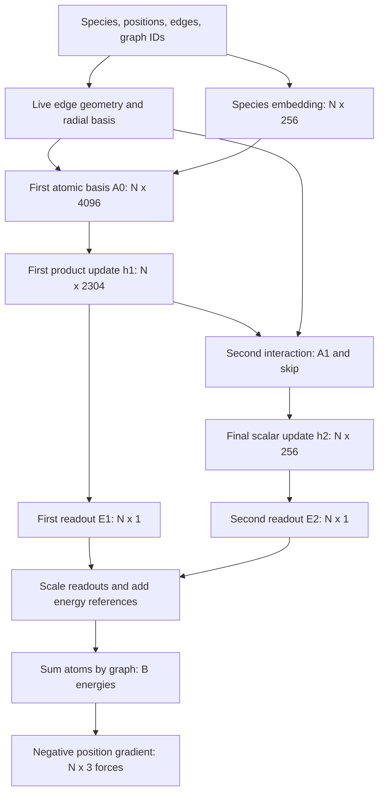
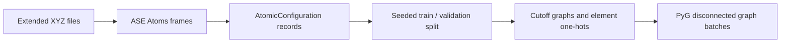
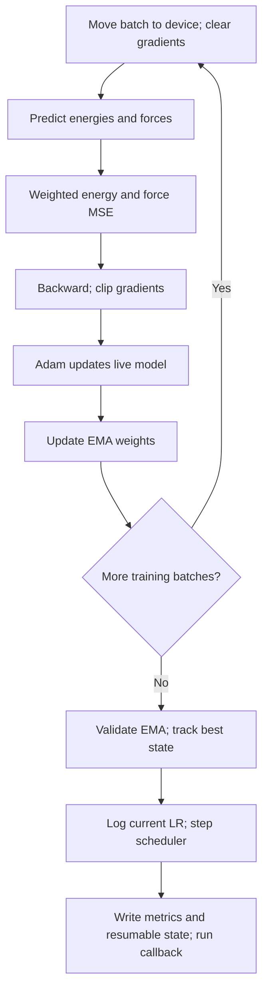
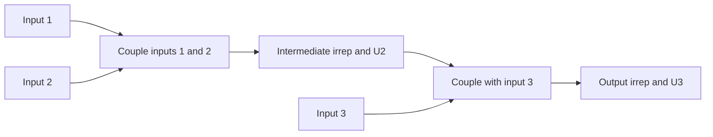

# MACE quick-revision notes

- **Purpose:** trace the local MACE implementation from atomic structures to energies, forces, and training updates.
- **Scope:** the bounded 3BPA reproduction in [model.py](src/model.py), [data.py](src/data.py), [train.py](src/train.py), and [evaluate.py](src/evaluate.py).
- **Revision route:** start with the pipeline, shape table, and equation map; open a component section for details.
- **Deeper indexing:** the [worked coupling examples](#worked-coupling-examples) preserve the correlation-2 and correlation-3 calculations.

## Contents

| Section | Use it to recall |
| --- | --- |
| [Overview and notation](#overview-and-notation) | Model flow, dimensions, irreps, and paper equations |
| [Data pipeline](#data-pipeline) | Frames, records, neighbour graphs, and batches |
| [Model architecture](#model-architecture) | Geometry, atomic basis, coupling, updates, energy, and forces |
| [Training](#training) | Statistics, loss, optimizer, EMA, validation, and checkpoints |
| [Evaluation](#evaluation) | Saved-model reconstruction and test metrics |
| [Worked coupling examples](#worked-coupling-examples) | Identity slices, recursion, flattening, and padding |
| [Python and PyTorch mechanics](#python-and-pytorch-mechanics) | Syntax used throughout the walkthrough |
| [Pedagogical coupling routes](#pedagogical-coupling-routes) | The optional `CouplingRoute` helper |
| [References](#references) | Source code, practice notebook, paper, and library documentation |

## Overview and notation

### One-minute recall

- **Data:** one molecular geometry has one total energy and one XYZ force vector per atom.
- **Geometry:** distances select neighbours; live positions supply differentiable edge vectors and lengths.
- **Atomic basis A:** combine distance, direction, and sender features; sum complete edge messages into receivers.
- **Higher order:** correlation 3 combines up to three A inputs within each update; it does not mean three interaction layers.
- **Fixed U:** generalized Clebsch–Gordan (CG) coefficients define legal angular coupling routes.
- **Learned weights:** mix channels and weight routes, including central-species dependence.
- **Hidden update:** transform the product message and add the supplied skip contribution.
- **Energy:** combine two readouts, restore the training reference and scale, then sum atoms within each configuration.
- **Forces:** differentiate configuration energy with respect to live atomic positions and negate the gradient.
- **Training:** update live weights with Adam; validate and save the best exponential moving average (EMA) model.

### Model pipeline



### Symbols and shapes

| Symbol | Meaning |
| --- | --- |
| `N` | Atoms across the current batch |
| `E` | Directed edges across the current batch |
| `B` | Configurations in the batch |
| `G`, `N_g` | Graph count and atom count of graph g in a statistics calculation |
| `l`, `L` | Angular order of an input or output irrep |
| `m`, `M` | One of an irrep's `2*l + 1` components |
| `k`, `c` | Feature-channel indices; local einsum letters can have different meanings |
| `nu` | Correlation order, or number of A inputs in a product |
| `eta_nu`, `p` | Coupling-path index at a given correlation order |
| `z_i`, `e` | Central atom's element type and its one-hot index |

| Tensor | Default shape | Contents |
| --- | --- | --- |
| `node_attrs` | `(N, 4)` | H/C/N/O one-hots |
| `positions`, returned `F_g` | `(N, 3)` | XYZ coordinates or force components |
| `edge_index` | `(2, E)` | Row 0 senders, row 1 receivers |
| Initial embedding | `(N, 256)` | Scalar species features |
| `edge_radial` | `(E, 8)` | Bessel features with cutoff envelope |
| `A0`, `A1` | `(N, 4096)` | Four angular blocks with 256 channels each |
| `h1` | `(N, 2304)` | Scalar, vector, and order-2 blocks |
| Final `h2`, `sc` | `(N, 256)` | Scalar-only final-stage features and skip |
| `E1`, `E2`, restored atomic energy | `(N, 1)` | One contribution per atom |
| Returned configuration energy `E_g` | `(B,)` | One energy per graph |

### Paper equation to code

| Equation | Component | Operation |
| --- | --- | --- |
| 9 | `first_atomic_basis` / `AtomicBasis` | First atomic basis from scalar sender species features |
| 8 | `second_interaction_block` / `InteractionBlock` | Next atomic basis from hidden sender features and edge geometry |
| 10 | Atomic-basis projection, fixed U, coupled products | Mix channels and couple products of A into legal outputs |
| 11 | `Contraction`, `SymmetricContraction` | Weight routes by central species and channel; sum correlation orders |
| 12 | `first_product_basis`, `second_product_basis` / `ProductBasisBlock` | Transform the message and add the skip contribution |
| 13 | `first_readout`, `second_readout` | Produce scalar energy contributions |

- **Caller chain:** `MACE.forward` → `ProductBasisBlock.forward` → `SymmetricContraction.forward` → each `Contraction.forward`.
- **Stage 1:** retains `0e`, `1o`, and `2e`; its skip is `None`.
- **Final stage:** requests only `0e` for the product update and skip; its atomic basis still includes orders 0–3.
- **Construction versus execution:** `__init__` creates modules, weights, and fixed buffers once; `forward` applies them to each batch.

### Irrep notation and parity

- **Irrep:** an irreducible representation, specifying how a feature block transforms.
- **`256x1o`:** 256 copies of angular order 1 with odd inversion parity; each copy has three components.
- **`+`:** joins feature blocks in a direct sum; it does not add their values numerically.
- **Hidden feature specification:** `config.hidden_irreps` returns a string; `o3.Irreps` interprets it as a layout.

| Angular type | Components per copy | With 256 channels | Natural parity |
| --- | --- | --- | --- |
| `0e` | 1 | 256 | Even scalar |
| `1o` | 3 | 768 | Odd vector |
| `2e` | 5 | 1280 | Even order-2 feature |
| `3o` | 7 | 1792 | Odd order-3 feature |

- **Atomic basis:** `256 * (1 + 3 + 5 + 7) = 4096` components; angular-only coupling layout has 16 components.
- **First hidden output:** `256 * (1 + 3 + 5) = 2304` components.
- **Inversion:** `(x, y, z) → (-x, -y, -z)`; even features stay unchanged, odd features change sign.
- **Examples:** distance and energy are even; displacement and force are odd; `xy`, `xz`, and `x² - y²` are even under inversion.
- **Rotation still acts on `2e`:** the parity label specifies inversion behavior, not invariance under every rotation.
- **Natural harmonic parity:** `Y_l^m(-r̂) = (-1)^l Y_l^m(r̂)`, giving `0e, 1o, 2e, 3o` for the angular basis.
- **General representations:** angular order and parity are independent labels; `0o` is an odd scalar, and `1e` can describe an axial vector such as a cross product.
- **Scalar species encoding:** one-hot element channels remain unchanged under rotation; four channels do not make a geometric vector.
- **Analogy:** `cos(-x) = cos(x)` and `sin(-x) = -sin(x)` illustrate even/odd behavior, though molecular features need not be sine or cosine.

## Data pipeline

- **Source:** [data.py](src/data.py); practice in [EDA_practice.ipynb](EDA_practice.ipynb).



### ASE frames and labels

- **ASE:** Atomic Simulation Environment; `Atoms` stores elements, positions, cell, periodic flags, arrays, metadata, and attached results.
- **Extended XYZ (`extxyz`):** element symbols and XYZ coordinates plus metadata and per-atom properties such as forces; one file can contain many frames.

```python
from ase import Atoms
from ase.io import read

frame = read(DATA_PATH, index=0, format="extxyz")
all_frames = read(DATA_PATH, index=":", format="extxyz")
energy = frame.get_potential_energy()
forces = frame.get_forces()
```

| Expression | Result in the practice data |
| --- | --- |
| `len(all_frames)` | 500 geometries of the same 27-atom molecule |
| `len(frame)` | 27 atoms; ordering fixed across snapshots |
| `frame.symbols` | Stored element order; does not specify bonds |
| `frame.numbers` | Atomic numbers H/C/N/O = 1/6/7/8 |
| `frame.positions` | `(27, 3)`, in angstroms |
| `frame.cell` | 50-angstrom cube |
| `frame.pbc` | `[False, False, False]`, with no periodic copies |
| `frame.arrays.keys()` | `numbers`, `positions` |
| `frame.info.keys()` | `dihedrals` |
| `frame.info["dihedrals"]` | Three selected torsion angles in degrees, per snapshot |
| `get_potential_energy()` | Stored scalar label in eV |
| `get_forces()` | Stored `(27, 3)` labels in eV/angstrom |

- **Stored results:** the attached single-point calculator retrieves labels; these calls do not launch a new simulation.
- **Torsion:** planes A-B-C and B-C-D twist around B-C; selected four-atom groups can share atoms.
- **Across 500 frames:** energies have shape `(500,)`; force magnitudes have shape `(500, 27)`.
- **Changes across snapshots:** positions, energies, and forces vary; the atoms and their ordering remain fixed.

### Atomic configurations and graphs

| Container | Role | Important behavior |
| --- | --- | --- |
| `AtomicConfiguration` | Keeps one snapshot's atomic numbers, positions, energy, and forces together | Frozen dataclass; input geometry stays paired with target labels |
| `AtomicGraph` | Stores that snapshot as a PyG `Data` graph | Adds edges and one-hot element attributes; sets `num_nodes` from positions |

| Field | One practice graph | Dtype / meaning |
| --- | --- | --- |
| `atomic_numbers` | `(27,)` | `torch.long`; discrete element IDs |
| `positions` | `(27, 3)` | Float64; model input |
| `node_attrs` | `(27, 4)` | Float64; H/C/N/O one-hots |
| `edge_index` | `(2, 146)` | Integer sender/receiver pairs in this practice graph |
| `energy` | `()` | Float64; total snapshot energy, not one energy per atom |
| `forces` | `(27, 3)` | Float64; one XYZ target per atom |

- **Element identity:** atomic numbers and one-hot attributes encode the same species in different forms; electrical charge would be a separate quantity.
- **H/C/N/O encoding:** H `[1,0,0,0]`, C `[0,1,0,0]`, N `[0,0,1,0]`, O `[0,0,0,1]`.
- **Python mechanics:** see [dataclasses, annotations, and properties](#python-and-pytorch-mechanics).

### Loading and splitting

| Function | Operation | Output / checks |
| --- | --- | --- |
| `load_extxyz` | Read frames; convert atomic numbers, positions, energy, and forces to tensors; create one record per frame | List of `AtomicConfiguration`; 500 records for the training file |
| `load_isolated_atom_energies` | Read `iso_atoms.xyz`; map atomic number to reference energy; stack in H/C/N/O order | Float64 `(4,)` tensor; reject multi-atom frames, unsupported species, duplicates, or missing species |
| `split_train_valid` | Use `np.random.default_rng(seed).permutation(...)` to shuffle indices without repetition | First 450 shuffled records train; remaining 50 validate; test files stay separate |
| `validate_data_dir` | Check required training, isolated-atom, and test paths with `.is_file()` | Raise `FileNotFoundError` listing sorted missing filenames |

- **Isolated-energy order:** `iso_atoms.xyz` begins C, then H; the returned tensor follows `ATOMIC_NUMBERS = (1, 6, 7, 8)` regardless of file order.
- **Isolated-frame check:** `len(atoms) != 1` detects an invalid record; `[0]` selects the sole atomic number of a valid frame.
- **Reproducible split:** same input length and seed reproduce the ordering; returned lists contain records, preserving geometry/label pairing.
- **Generator distinction:** `default_rng` returns a local generator; `np.random.seed` sets global state and returns `None`.
- **File validation:** `TEST_FILES` maps conditions to tuples of filenames; file-presence checks do not inspect contents.
- **Device transfer:** loading creates tensors; the training loop later moves each graph batch with `batch.to(device)`.

### Neighbour topology and element encoding

- **`build_neighbor_graph` inputs:** one `AtomicConfiguration` and a cutoff, default 5 angstroms.
- **Selection:** visit ordered sender/receiver pairs; exclude self-edges; keep distances strictly below the cutoff.
- **Directed edges:** an in-cutoff pair creates both `3 → 7` and `7 → 3`; edges come from geometry rather than chemical-bond labels.
- **Cutoff equality:** an edge exactly at the cutoff is excluded.
- **Assembly:** matched sender and receiver lists form `edge_index`, with senders in row 0 and receivers in row 1.
- **Topology versus geometry:** preprocessing uses distances to choose edges; the model recomputes differentiable vectors and lengths from live positions.
- **Species indices:** `ATOMIC_NUMBER_TO_INDEX` maps `1/6/7/8 → 0/1/2/3`; `[6,1,8,7] → [1,0,3,2]` without sorting atoms.
- **One-hot expansion:** the index vector `(N,)` becomes `(N,4)` and is converted to float64; the original atomic numbers remain stored.

### Graph batching

- **`get_data_loader`:** receives a `Sequence[AtomicGraph]`, batch size, shuffle flag, and `drop_last` flag.
- **PyG loader:** `torch_geometric.loader` concatenates atom tensors, offsets edges, and creates the per-atom `batch` assignment.
- **Disconnected configurations:** batches contain no edges between molecules.

| Two 27-atom graphs | Batched result |
| --- | --- |
| Positions and forces | `(54,3)` |
| Element attributes | `(54,4)` |
| Energies | `(2,)` |
| `batch` | `(54,)`: 27 zeros followed by 27 ones |
| Second graph's edge `3 → 7` | Offset to `30 → 34` |

- **Batch size:** counts configurations, not atoms.
- **`drop_last=True`:** drops only an incomplete final batch; 500 graphs at batch size 32 produce 15 full batches plus 20 graphs, and only that final group is dropped.
- **Default training:** five configurations per batch; validation does not shuffle or drop its final incomplete batch.

## Model architecture

- **Source:** [model.py](src/model.py); use the [pipeline and equation map](#overview-and-notation) to locate each block.
- **Setup entry:** `MACE.__init__` creates the modules used by `MACE.forward`.

### Configuration and construction

| `MACEConfig` setting | Default | Meaning |
| --- | --- | --- |
| `num_elements` | 4 | H, C, N, O |
| `channels` | 256 | Learned copies of each angular type |
| `num_interactions` | 2 | Successive message-passing stages |
| `correlation` | 3 | Maximum number of A inputs in a coupled product |
| `max_ell` | 2 | First hidden output retains orders 0, 1, 2 |
| `spherical_harmonics_max_ell` | 3 | Edge harmonics use orders 0–3 |
| `cutoff` | 5.0 angstroms | Neighbour radius |
| `num_radial_basis` | 8 | Distance features per edge |
| `envelope_power` | 5 | Dimensionless cutoff-polynomial parameter |
| `radial_mlp_widths` | `(64,64,64,1024)` | First radial MLP hidden and output widths |
| `readout_hidden_width` | 16 | Hidden scalar features in the final readout |

- **Validation:** `__post_init__` requires positive element/channel counts, cutoff, and radial-basis count; exactly two interactions, correlation 3, hidden order 2, and harmonic order 3.
- **Overrides:** dataclass defaults can be overridden, but unsupported settings raise `ValueError`; `MACEConfig(num_interactions=3)` is rejected.
- **Interaction versus neural layer:** each interaction contains several operations; two interactions mean more than two linear layers.
- **Body order:** the first stage's three-A products include up to the central atom plus three neighbours; repeated neighbour indices also produce lower-body terms. Later stages combine features already depending on neighbourhoods.
- **Constructor inputs:** configuration, average incoming-neighbour count, isolated-atom energies, mean residual-energy shift, and force RMS scale.
- **Energy-reference checks:** absent atomic energies default to a zero vector of length `num_elements`; supplied energies must have that shape, and `rms_forces` must be positive.
- **Fixed buffers:** `atomic_energies`, `mean_energy_shift`, and `rms_forces` use float64, move with the model, and are included in its saved state; the optimizer does not learn them.
- **Neighbour normalization:** the fixed average is calculated from training graphs and used in the atomic-basis blocks.

### Species embedding

- **Layer:** `o3.Linear("4x0e", "256x0e")` uses e3nn initialization and normalization.
- **Input → output:** `(N,4)` species one-hots → `(N,256)` scalar features.
- **Lookup interpretation:** a one-hot row selects its species' weight-matrix column.
- **Initial equality:** atoms of the same element initially share an embedding; later blocks incorporate geometry.
- **Paper connection:** the species embedding supplies the sender-element factor `W_(k,z_j)` in equation 9.
- **Sender transform:** the first atomic basis also applies `sender_linear`; it can be absorbed into the initial embedding, but this reproduction retains the author's parameterization.

### Differentiable edge geometry

- **`edge_vectors_and_lengths`:** transpose `(2,E)` edges to `(E,2)` and visit each sender/receiver pair.
- **Direction:** destination minus origin points from sender to receiver.

\[
\mathbf v=\mathbf R_{\mathrm{receiver}}-\mathbf R_{\mathrm{sender}},
\qquad d=\|\mathbf v\|_2=\sqrt{v_x^2+v_y^2+v_z^2}.
\]

| Input / output | Shape | Example |
| --- | --- | --- |
| Positions | `(N,3)` | Sender `(1,0,0)`, receiver `(4,0,0)` |
| `edge_vectors_tensor` | `(E,3)` | Displacement `(3,0,0)` |
| `edge_distances_tensor` | `(E,1)` | Length 3 |

- **Assembly:** stack vector tensors; stack scalar distances to `(E,)`, then reshape to `(E,1)`.
- **Return order:** vectors first, distances second.
- **Force requirement:** live geometry preserves the differentiation path from energy back to positions.

### Bessel features and smooth cutoff

- **`BesselRadialBasis`:** maps `(E,1)` distances to `(E,8)` features using indices `n=1,...,8`.
- **Parameters:** cutoff `r_c=5.0` angstroms and envelope power `p=5`.
- **Nonzero-distance basis:** the square root covers `2/r_c`; the sine is divided by distance.

\[
b_n(r)=\sqrt{\frac{2}{r_c}}\frac{\sin(n\pi r/r_c)}{r}.
\]

- **Zero-distance branch:** avoids `0/0` by using the finite limit separately on zero-distance rows.

\[
\lim_{r\to0}\frac{\sin(ar)}{r}=a,
\qquad b_n(0)=\sqrt{\frac{2}{r_c}}\frac{n\pi}{r_c}.
\]

- **Envelope:** with `x=r/r_c`, the dimensionless polynomial is:

\[
f(x)=1-21x^5+35x^6-15x^7.
\]

- **Boundary behavior:** starts at 1; reaches 0 at the cutoff with zero first and second derivatives; `distances < cutoff` makes it zero at and beyond the cutoff.
- **Broadcasting:** the `(E,1)` envelope scales all eight features of the same edge.
- **Topology and smoothness:** graph construction excludes out-of-cutoff edges; the radial module independently enforces zero features at the boundary.
- **Implementation shapes:** zero-distance mask `(E,)`; output initialized with `zeros_like(distances).repeat(1,8)`; basis indices and the constant `tensor_2` match input dtype/device.

### First atomic basis: equation 9

- **`AtomicBasis.forward`:** combines radial weights, edge harmonics, and gathered scalar sender embeddings; accumulates complete messages into receivers.
- **Radial MLP:** `8 → 64 → 64 → 64 → 1024`, with SiLU after hidden layers and a linear output.
- **Weight layout:** reshape `(E,1024)` to `(E,4,256)`, then transpose to `(E,256,4)`; consecutive outputs represent channels within an angular order.
- **Checkpoint convention:** a direct `(E,256,4)` reshape is possible with consistent parameterization, but transferring weights requires permuting the final MLP outputs.
- **Harmonic blocks:** split `(E,16)` by lengths `[1,3,5,7]`; these are lengths, not split indices.
- **Sender selection:** apply the embedding's `sender_linear`, then gather using `edge_index[0]`; there is no extra existing message to multiply.

| Edge factor at angular order l | Shape | Role |
| --- | --- | --- |
| Radial weight | `(E,256,1)` | Distance-dependent scale per channel/order |
| Harmonic block | `(E,1,2*l+1)` | Direction components |
| Sender embedding | `(E,256,1)` | Sender species features |
| Product | `(E,256,2*l+1)` | Complete edge message |

\[
A_{i,k\ell m}=\sum_{j\in\mathcal N(i)}
R_{k\ell}(r_{ji})Y_{\ell m}(\hat{\mathbf r}_{ji})W_{k,z_j}.
\]

- **Shared angular scaling:** each channel's radial weight and sender feature scale every component of its selected angular block.
- **Receiver sum:** `index_add_(0, receiver_index, edge_message)` changes the leading axis from edges E to atoms N; shared receivers add messages into the same row.

| Angular order | Receiver-accumulated block | Flattened block |
| --- | --- | --- |
| 0 | `(N,256,1)` | `(N,256)` |
| 1 | `(N,256,3)` | `(N,768)` |
| 2 | `(N,256,5)` | `(N,1280)` |
| 3 | `(N,256,7)` | `(N,1792)` |

- **Packing:** append flattened blocks to `agg_messages`, then concatenate along dimension 1 to A; order is angular block, then channel, then angular component. No further flattening is needed.
- **`atomic_basis_projection`:** mixes channels separately for each angular order, implementing the channel-mixing factor upstream of equation 10's products.
- **Normalization:** divide by the fixed training-set average neighbour count.
- **`receiver_selector`:** element one-hots select a learned 256-by-256 channel matrix per angular order and central species, shared over magnetic components; atom and angular-type axes remain separate.
- **Author-code detail:** the receiver selector is retained alongside the sender linear.

### Second interaction: equation 8 and the skip

- **`InteractionBlock.forward` inputs:** hidden sender features `h1` and central-species one-hots.
- **Separate branches:** `skip_tp` creates the final stage's scalar skip; `sender_linear` retains scalar/vector/order-2 features for building the next A.
- **Sender gather:** `mixed_node_features[edge_index[0]]` supplies per-edge sender features.
- **Skip limitation:** the scalar skip has discarded vector and order-2 features and uses a different element-conditioned transform; it cannot replace the sender branch.
- **Output:** return the new full angular atomic basis A1 and the separately computed scalar skip.
- **Specification versus values:** `edge_irreps` specifies angular types; `edge_vectors` supplies actual directions for the harmonics.

| Operation | Shape |
| --- | --- |
| Input and mixed hidden features | `(N,2304)` |
| Gathered sender features | `(E,2304)` |
| Edge harmonics | `(E,16)` |
| Final-stage skip | `(N,256)` |

#### Tensor-product routes and instructions

- **`tensor_product_instructions`:** iterate over hidden/harmonic irrep blocks, enumerate `input_irrep * edge_irrep`, and filter by the target A specification.
- **Distinct route blocks:** `0e × 0e → 0e`, `1o × 1o → 0e`, and `2e × 2e → 0e` each keep their own 256-channel block and radial weights until projection.
- **Instruction:** `(input_index, edge_index, output_index, "uvu", True)` connects input blocks to an intermediate output block.
- **Index meaning:** the instruction's output index is a block position, not angular order L.
- **`"uvu"`:** output channels align with hidden-input channels; `True` enables externally supplied weights.
- **Sorting:** output blocks are sorted by irrep type and instructions remapped. For old types `[2e,0e,1o]`, sorted types are `[0e,1o,2e]`, with old-to-new mapping `(2,0,1)`.
- **Repeated types:** sorting preserves distinct blocks of the same type.
- **`InteractionBlock.__init__`:** stores the sorted result as `self.intermediate_irreps` and passes it as the output specification to `o3.TensorProduct`; the first two specifications describe the hidden and harmonic inputs.
- **Tensor-product forward:** the third argument supplies radial weights.
- **External weights:** `internal_weights=False` stores no internal learned route weights; `shared_weights=False` permits different weights per edge.

| Sorted intermediate indices | Type | Blocks | Components per atom/edge |
| --- | --- | --- | --- |
| 0–2 | `256x0e` | 3 | `256 * 3 * 1` |
| 3–7 | `256x1o` | 5 | `256 * 5 * 3` |
| 8–12 | `256x2e` | 5 | `256 * 5 * 5` |
| 13–16 | `256x3o` | 4 | `256 * 4 * 7` |

#### Radial weights, aggregation, and projection

- **Radial MLP:** `8 → 64 → 64 → 64 → 4352`; SiLU hidden layers, linear output; `4352 = 17 * 256 = edge_tensor_product.weight_numel`.
- **Weight meaning:** unrestricted distance-dependent scaling values, not probabilities.
- **Edge tensor product:** combines sender `(E,2304)`, harmonics `(E,16)`, and weights `(E,4352)` into route features `(E,18176)`.
- **Route feature count:** `18176 = 256 * (3*1 + 5*3 + 5*5 + 4*7)`; angular components contribute to width.
- **Receiver aggregation:** `index_add_` sums route features into `(N,18176)`, then divides by the average neighbour count.
- **Equivariant projection:** `o3.Linear(intermediate_irreps, atomic_basis_irreps)` combines matching angular types into A1; no activation is applied.
- **Vector example:** five vector routes give `(N,1280,3)`; one shared channel map reduces this to `(N,256,3)`:

\[
A_{n,c,m}=\sum_a W_{ca}F_{n,a,m}.
\]

- **Equivariance constraint:** W has no component index m; the same channel map acts on all vector components. An unrestricted 3840-to-768 linear layer would not enforce that constraint.
- **Other orders:** each angular type has its own channel map.
- **Input layout versus intermediate layout:** the target filters permitted types; the intermediate result can contain several blocks of each type before projection.

### Fixed coupling tensors: equation 10

- **`u_matrix_real` inputs:** angular-only layout `0e + 1o + 2e + 3o`, one requested output irrep, correlation order, normalization convention, and dtype.
- **Channel stripping:** fixed U tensors couple 16 angular components; the 256 learned channels are handled separately.
- **Validation:** correlation must be positive; absent dtype uses the current default.
- **Repeated specification:** `(coupling_irreps,) * correlation` describes that many ordered inputs; it does not multiply feature values.
- **`_wigner_nj`:** recursively combine all inputs except the last, then couple each intermediate path with the last input using `o3.wigner_3j`.
- **Return entries:** `(output_irrep, padded_u)`, one fixed coefficient tensor per route; several routes can share an output type.
- **Output filter:** retain only paths matching the requested output before stacking, so every retained tensor has the same shape.
- **New path axis:** `torch.stack(u_paths, dim=-1)` gives `[out_dim, 16, ..., 16, num_paths]`, with one input axis per correlation input.
- **Empty result:** return a zero tensor with a size-1 placeholder path axis to preserve the shape contract.
- **Fixed versus learned:** U tensors are registered buffers; route weights are learned parameters.
- **Separate output types:** first-stage `SymmetricContraction` creates one `Contraction` per `0e`, `1o`, and `2e`; final-stage contraction requests only `0e`.
- **Setup cost:** each output-specific construction reruns full path generation for each correlation order before filtering. Buffers are reused during forward passes; initialization cost was not timed in the walkthrough.
- **Detailed indexing:** see [worked coupling examples](#worked-coupling-examples).

### Weighted messages: equation 11

- **`ProductBasisBlock.__init__`:** creates `SymmetricContraction` and a message linear layer; optional `output_irreps` defaults to the hidden layout, with the final stage overriding it to `256x0e`.
- **`SymmetricContraction.__init__`:** stores the input/output specifications and creates a registered `nn.ModuleList` of output-specific `Contraction` modules.
- **One module per output type:** each module handles all its routes at orders 1, 2, and 3; there is no separate module per route.
- **Constructor indices:** `mul_irrep.ir` extracts one output irrep from a multiplicity/type entry; `self.correlation` stores the maximum order 3.
- **Unpacking A:** split the angular blocks, reshape each into `(N,256,2*l+1)`, then concatenate their component axes into `x` of shape `(N,256,16)`.
- **Packing caveat:** a whole-tensor reshape would mix channels and angular types in the packed ell-first layout.
- **Species and channel weights:** one learned weight per receiver element, route, and channel, separately at each correlation order.
- **Message:** sum weighted route contributions across correlation orders:

\[
m_{i,kLM}=\sum_{\nu=1}^{3}\sum_{\eta_\nu}
W_{z_i kL,\eta_\nu}B_{i,\eta_\nu kLM}.
\]

- **Paper indices:** `nu` selects order; `eta_nu` selects path; `xi` labels an A input inside equation 10's product.
- **Channel mixing:** equation 10's learned channel mixing already occurs in the upstream A projection; the weights below are equation 11's route weights.

#### First order-3 contraction

```python
out = torch.einsum(
    "mijkp,epc,nck,ne->ncmij",
    u_max, self.weights_max, x, node_attrs,
)
```

| Tensor | Indices | Axis meaning |
| --- | --- | --- |
| `u_max` | `m i j k p` | Output component, three input angular slots, path |
| `weights_max` | `e p c` | Central species, path, feature channel |
| `x` | `n c k` | Atom, channel, angular component |
| `node_attrs` | `n e` | Atom, species one-hot |

\[
\mathrm{out}_{ncmij}=\sum_{e,p,k}U_{mijkp}W_{epc}X_{nck}z_{ne}.
\]

- **Contracted:** species e, path p, and one input angular slot k.
- **Retained:** atom n, channel c, output component m, and two remaining input slots i/j.
- **Result:** `(N,256,out_dim,16,16)`; only one of the three A inputs has been consumed.
- **Index distinction:** i/j/k here are angular slots, not atom IDs; the paper's atom i and channel k become code n and c.
- **Species lookup:** for carbon, `node_attrs[n] = [0,1,0,0]`, so `sum_e W[e,p,c] * z[n,e] = W[C,p,c]`.
- **Per-atom alignment:** n appears in both inputs and the output; it is not summed or grouped by element.

#### Nested evaluation of orders 3, 2, and 1

```python
c_tensor = torch.einsum("mijp,epc,ne->ncmij", u_2, weights_2, node_attrs)
out = out + c_tensor
out = torch.einsum("ncmij,ncj->ncmi", out, x)

c_tensor = torch.einsum("mip,epc,ne->ncmi", u_1, weights_1, node_attrs)
out = out + c_tensor
out = torch.einsum("ncmi,nci->ncm", out, x)
return out.flatten(start_dim=1)
```

| Step | Combined expression | Remaining shape |
| --- | --- | --- |
| Start order 3 | `U3 W3 X[k]` | `(N,256,out_dim,16,16)` |
| Add order-2 stencil | `U3 W3 X[k] + U2 W2` | Same |
| Consume j | `U3 W3 X[k] X[j] + U2 W2 X[j]` | `(N,256,out_dim,16)` |
| Add order-1 stencil | Previous expression `+ U1 W1` | Same |
| Consume i | `U3 W3 X[k] X[j] X[i] + U2 W2 X[j] X[i] + U1 W1 X[i]` | `(N,256,out_dim)` |
| Flatten channel/component axes | One output-irrep block | `(N,256*out_dim)` |

- **Scalar analogy:** `a3*x**3 + a2*x**2 + a1*x` becomes `((a3*x + a2)*x + a1)*x`.
- **Multiplication counts:** six when computing terms separately without sharing powers, five with shared powers, three in nested form; all use two additions.
- **Performance caveat:** these scalar counts explain reuse; they do not establish a twofold tensor-model speedup. Tensor cost depends on dimensions, paths, and contraction plans.
- **Packing outputs:** `SymmetricContraction.forward` calls each module on the same A and one-hots, then concatenates output blocks along the feature axis.

### Hidden-feature update: equation 12

- **`ProductBasisBlock.forward` inputs:** `node_features` is atomic basis A, `sc` is a transformed previous hidden state or `None`, and `node_attrs` selects central species.
- **Message linear:** mixes compatible channels while preserving output angular types.
- **Update:** `updated hidden features = message_linear(m) + sc`, when a skip exists.
- **First stage:** skip is `None`; full hidden-output layout is retained.
- **Second stage:** `InteractionBlock` constructs A1 and the scalar element-conditioned skip from h1; the product block adds the skip after message transformation.
- **Equation roles:** equations 8–9 build A; equations 10–11 produce product features and message m; equation 12 updates h.

### Readouts and energy restoration

- **First readout:** equivariant linear map from first hidden features to one scalar contribution per atom.
- **Final readout:** scalar hidden features pass through:

```text
256x0e → equivariant linear → 16x0e
       → normalized SiLU   → 16x0e
       → equivariant linear → 1x0e
```

- **Normalized activation:** e3nn applies approximately `1.67918 * SiLU(x)` to these even scalars, normalizing expected squared output for standard-normal input.
- **Effect:** the next linear layer can absorb the fixed factor; it changes initialization/optimization conventions without adding expressive power.
- **Width 16:** matches the paper's training setup; other scalar widths preserve symmetry but change capacity. It is independent of the 16 angular components in A.
- **Atomic energy restoration:** only the learned readout sum is multiplied by the force RMS scale:

```python
E = self.rms_forces * (E1 + E2) + self.mean_energy_shift + atomic_baseline
```

- **Baseline lookup:** `node_attrs @ atomic_energies.unsqueeze(-1)` selects a reference per atom's species, producing `(N,1)`.
- **Reference interpretation:** isolated-atom baseline + training mean residual + scaled learned deviation.
- **Zero readouts:** the prediction becomes baseline plus mean residual correction.
- **Numeric example:** baseline `-100`, mean shift `-2`, scale `4`, `E1=0.25`, `E2=0.50` give `4*(0.25+0.50)-2-100 = -99`, a learned `+3` deviation from reference `-102`.
- **Statistics definitions and calculation:** see [training statistics](#training-statistics).

### From atomic energies to configuration energies

- **Accumulator:** `E.new_zeros((graph_index.max()+1, E.shape[1]))` creates `(B,1)` with matching dtype/device.
- **Graph IDs:** assign each atom to a configuration, from 0 through `B-1`.
- **Atom sum:** `E_g.index_add_(0, graph_index, E)` adds atomic contributions within each configuration.
- **Example:** energies `[10,20,30,40]` with graph IDs `[0,0,1,1]` give configuration totals `[30,70]`.
- **Final shape:** `squeeze(-1)` changes `(B,1)` to `(B,)`; forces retain `(N,3)`.

### Forces and gradients through forces

\[
\mathbf F_i=-\frac{\partial E}{\partial\mathbf R_i}
=-\left(\frac{\partial E}{\partial x_i},
\frac{\partial E}{\partial y_i},\frac{\partial E}{\partial z_i}\right).
\]

```python
torch.autograd.grad(
    energy.sum(), positions,
    create_graph=training, allow_unused=True,
)
```

- **`forces_from_energy`:** unpack the returned position-gradient tuple, negate it, and return `(N,3)`.
- **Batched scalar:** `energy.sum()` combines configuration energies into one scalar for differentiation; configurations remain independent because there are no cross-graph edges.
- **Independent derivative:** `d(E_A(R_A)+E_B(R_B))/dR_A = dE_A/dR_A`.
- **Equal coordinates:** `E_A=x_A²`, `E_B=x_B²`, `x_A=x_B=2` still give separate derivatives `(4,4)`; indices remain distinct.
- **Training:** `create_graph=True` records the force derivative so the force loss can differentiate through it to model parameters.
- **Evaluation:** `create_graph=False` still computes position derivatives but omits the additional derivative graph used for weight training.
- **Gradient prerequisites:** positions must participate in a differentiable energy computation; MACE enables their gradients before its forward calculations.
- **Unused positions:** `allow_unused=True` permits a disconnected input; a returned `None` becomes `zeros_like(positions)` with matching shape/dtype/device.
- **Zero derivative distinction:** a connected computation with zero derivative normally returns a zero tensor; the fallback is not a special first-training-iteration rule.
- **Autograd limitation:** `allow_unused` does not enable gradients on an output that lacks them.
- **Reference independence:** the baseline and mean shift are position-independent, so `F = -rms_forces * gradient_positions((E1+E2).sum())`.
- **Training objective:** see [loss and optimizer](#loss-and-optimizer) for component-wise force errors and their reduction.

## Training

- **Source:** [train.py](src/train.py); command entry `main()` builds `TrainConfig` and calls `train` with data path, device, and optional resume ID.

### Preparation and precision

- **Setup:** set default dtype to `torch.float64`, resolve the data path, select CPU/CUDA, and set the random seed.
- **CG precision:** set float64 before constructing MACE directly; converting a float32 CG tensor afterward cannot recover lost precision.
- **Graphs:** use `model_config.cutoff` for training and validation; holdout files stay separate from the seeded 450/50 split.
- **Loaders:** use `train_config.batch_size`, normally five; shuffle training, apply its configured `drop_last`, and retain all validation examples without shuffling.
- **Statistics:** compute energy references, mean residual shift, force RMS, and neighbour normalization from training graphs only.
- **Model:** construct with those statistics, convert to double precision, and move to the selected device.
- **Run directory:** create and configure a fresh run, or find the supplied resume run and validate its saved recipe; absent paper directory is derived from the script path.

### Training statistics

- **`load_isolated_atom_energies`:** supplies the ordered H/C/N/O reference tensor described in the [data pipeline](#data-pipeline).
- **`compute_mean_rms_energy_forces`:** computes residual energy per atom and the RMS of reference force components.
- **Reference-energy lookup:** atomic numbers `{1,6,7,8}` map to reference indices `{0,1,2,3}`; the nested lookup/sum gives one isolated-reference sum per graph.
- **DFT:** density functional theory; `E_DFT,g` is the interacting configuration's dataset reference energy, distinct from its sum of isolated-atom references.

\[
E_{\mathrm{iso},g}=\sum_{a\in g}E_{\mathrm{iso}}(Z_a),
\qquad
\mu_E=\operatorname{mean}_g\left(
\frac{E_{\mathrm{DFT},g}-E_{\mathrm{iso},g}}{N_g}\right).
\]

- **Averaging order:** subtract the whole graph baseline, divide by that graph's atom count, then average graph residuals.
- **Shapes:** `graph_dft_energies`, `graph_iso_energies`, and `n_atoms` each have one entry per training graph, shape `(G,)`, with matching graph order.
- **Force components:** flatten `(N_g,3)` to `(3*N_g,)` and concatenate all training graphs; average components across all training atoms.

\[
s_F=\sqrt{\frac{1}{3M}\sum_{a=1}^{M}
\left(F_{ax}^2+F_{ay}^2+F_{az}^2\right)}.
\]

| Quantity for force `(3,4,0)` | Calculation | Value |
| --- | --- | --- |
| Vector magnitude of one atom | `sqrt(3²+4²+0²)` | 5 |
| Mean squared component | `(3²+4²+0²)/3` | `25/3`, with squared force units |
| Component RMS | `sqrt((3²+4²+0²)/3)` | About 2.89 |
| Force prediction RMSE | RMS of predicted-minus-target components | Requires prediction errors, not reference forces alone |

- **Statistic meaning:** `s_F` is a fixed reference-data scale; the local variable `rmse_forces` does not make it a prediction-error metric.
- **Magnitude array:** one snapshot has one magnitude per atom, not one magnitude for the whole molecule.
- **Model use:** `mu_E` is added back per atom; `s_F` scales the learned readout sum; see [energy restoration](#readouts-and-energy-restoration).
- **Recorded values:** from `train_300K.xyz`, seed 123, default 450/50 split:

| Statistic | Recorded value |
| --- | --- |
| Mean residual shift | `-4.873118444762043` eV/atom |
| Force-component RMS | `0.9461023467607689` eV/angstrom |

- **`compute_average_num_neighbors`:** count occurrences of each receiver in `graph.edge_index[1]`, concatenate counts across graphs, convert to floating dtype, and average.
- **Example:** receivers `[0,0,1,1,1,2]` give counts `[2,3,1]` and mean 2.
- **Weighting:** receiver atoms contribute equally; this is not an equally weighted mean of graph-level averages.
- **Local limitation:** zero-neighbour atoms never occur in `torch.unique(..., return_counts=True)` and are omitted by this implementation.

### Loss and optimizer

- **`energy_force_loss`:** energy mean squared error (MSE) over configurations plus force-component MSE, normally weighted 1 and 1000.

\[
L=\lambda_E L_E+\lambda_F L_F,
\qquad
L_F=\frac{1}{3N}\sum_{a=1}^{N}\sum_{\alpha\in\{x,y,z\}}
\left(F^{\mathrm{pred}}_{a\alpha}-F^{\mathrm{target}}_{a\alpha}\right)^2.
\]

| Reduction | Shape / example |
| --- | --- |
| Predicted/target forces | `(N,3)` |
| Squared force errors | `(N,3)` |
| Mean force loss | Scalar; one 27-atom graph averages 81 squared errors |
| Energy MSE | Scalar; average squared total-energy errors across configurations |

- **Error reduction:** square component errors before averaging; averaging raw signed errors allows cancellation.
- **Predictions remain separate:** reducing errors to a scalar loss does not replace the `(N,3)` predicted-force tensor with a summed force.
- **Autograd:** `loss.backward()` differentiates through energy and force predictions to model weights.
- **`make_optimizer`:** Adam with the configured learning rate and reference parameter groups.

| Parameter group | Weight decay |
| --- | --- |
| Both atomic-basis projections; all product-block parameters | Configured decay |
| Embedding, sender linears, receiver selectors, readouts | Zero |

- **Adam decay convention:** adds `lambda * weight` to the loss gradient, discouraging large weights.
- **Gradient clipping:** after backward, limit the combined parameter-gradient norm to 10; scale all gradients together if needed. `None` disables clipping.
- **Clip meaning:** constrains gradients, not final Adam update size or predicted force magnitude.

### Scheduler and EMA

| Mechanism | Changes | Trigger |
| --- | --- | --- |
| `ReduceLROnPlateau` | Adam learning rate | EMA validation loss |
| EMA averaging | Shadow model weights | After each live-weight update |
| EMA warmup | Shadow model's effective averaging decay | Averaging update count |

- **Scheduler:** `mode="min"`; insufficient improvement over configured patience multiplies learning rate by its factor.
- **Example:** factor 0.8 changes learning rate 0.01 to 0.008.
- **Patience:** default 50 validation checks, once per epoch here; it is not measured in training batches.
- **EMA rule:** blend the previous average with current live weights:

\[
w_{\mathrm{EMA,new}}=d\,w_{\mathrm{EMA,old}}+(1-d)w_{\mathrm{live}}.
\]

- **Decay 0.99 example:** average 2 and live weight 3 produce 2.01.
- **Tradeoff:** higher decay smooths noisy updates but follows changes more slowly; decay 0.99 has roughly 100-update characteristic memory, with older terms fading gradually.
- **Warmup:** `ema_average` uses `effective_decay = min(decay, (1+updates)/(10+updates))`, giving live weights more influence early.

| Update count | Effective decay with maximum 0.99 |
| --- | --- |
| 1 | About 0.182 |
| 10 | 0.55 |
| 100 | About 0.918 |
| 1000 | 0.99 |

- **Counter starts at 1:** the first EMA update blends initial and updated weights.
- **Application:** `ema_model.update_parameters(model)` runs after each optimizer step.
- **Separate operations:** EMA warmup changes shadow-model tracking; the scheduler changes Adam's learning rate. Neither restarts the other.

### Epoch and batch flow



- **Epoch range:** `range(start_epoch, max_epochs)` begins with the next epoch and excludes the upper bound.
- **Training mode:** `model.train()` selects training behavior.
- **Batch transfer:** `batch.to(device)` moves graph tensors together.
- **Clear gradients:** `optimizer.zero_grad(set_to_none=True)` prevents accumulation across ordinary updates.
- **Diagnostic cap:** `max_train_batches=2` processes batch indices 0 and 1; it limits batches, not configurations within a batch.
- **Outputs:** prediction returns energies `(B,)` and forces `(N,3)`; the configured loss reduces them to a scalar.
- **Update order:** backward → optional clip → optimizer step → EMA update.

### Validation and best-model selection

- **`compute_validation_loss`:** set the supplied model to evaluation mode, identify its device, move each batch, and compute the same weighted energy/force loss.
- **EMA selection:** the training loop validates the averaged model, not the live model.
- **Detach:** append `loss.detach()`; stack and average batch losses into a Python number without retaining their gradient graphs.
- **Autograd stays available:** force prediction still needs position derivatives; validation performs no loss backward or optimizer update.
- **Averaging limitation:** validation averages batch losses equally, including a smaller final batch; test RMSE instead aggregates predictions across the full condition.
- **Best tracking:** reject non-finite loss; on improvement save loss/epoch and independent CPU copies of EMA weights and buffers using `detach().cpu().clone()`.
- **Scheduler/log order:** read the current learning rate for logging before `scheduler.step(validation_loss)` advances the scheduler.

### Run metadata, checkpoints, and resume

| Artifact / helper | Purpose |
| --- | --- |
| `run_config` / `config.json` | Full data/model/training recipe and provenance |
| `metrics.jsonl` | Epoch metrics; also printed by `log_metrics` |
| `training_state.pt` | Per-epoch live/EMA, optimizer, scheduler, RNG, and tracking state for resuming |
| `checkpoint.pt` | Best-validation EMA state; updated when validation improves |
| `_load_training_state` | Restore state and return next epoch and best-validation tracking |
| Run-file reconciliation | Align logs and best checkpoint with the persisted training state |

- **Data metadata:** dataset path, isolated references, mean energy shift, force RMS, average incoming-neighbour count.
- **Other metadata:** `asdict(model_config)` and `asdict(train_config)`, seed, metric, device, implementation version, and pinned `author_revision` provenance.
- **Version policy:** implementation version 2 is metadata, not a checkpoint-rejection gate; configuration and weight-shape compatibility are still checked.
- **Resume boundary:** restart from the last saved epoch, not unsaved progress within an epoch; weights alone cannot restore Adam/scheduler history.
- **Epoch-limit guard:** reject a target epoch limit below the already completed count.
- **Return:** training returns run ID and path when its loop ends.
- **`on_epoch_checkpoint`:** optional callback after epoch files are saved; local training normally uses `None`.
- **Modal callback:** `runs_volume.commit` persists the run files to the volume; the callback does not itself save the model checkpoint.

## Evaluation

- **Source:** [evaluate.py](src/evaluate.py); `main()` accepts run ID, data path, and device, then calls `evaluate`.

### Reconstructing the saved model

1. Set default dtype to float64; validate data paths and select device.
2. Read the saved run configuration and restore `MACEConfig`, including radial-width list → tuple conversion.
3. Rebuild MACE with saved architecture and training statistics; convert to double precision and move to device.
4. Load the best EMA checkpoint; reuse training normalization rather than recomputing it on test data.
5. Read saved batch size and evaluate the 300 K, 600 K, 1200 K, and pooled-dihedral conditions.

- **Conditions:** separate test datasets, not cross-validation folds; each loads its files and builds graphs using the saved cutoff.
- **Results:** the condition-keyed dictionary stores energy and force RMSE, not validation loss.

### Collecting predictions and calculating metrics

- **`_evaluate_graphs`:** use an unshuffled loader and four lists for predicted/target energies and forces.
- **Gradient mode:** call `model.eval()` and enable autograd for position derivatives; evaluation does not update weights.
- **Batch processing:** move tensors to device, predict, detach outputs/targets, transfer to CPU, and append.
- **Global metrics:** concatenate all batches within a condition, then subtract targets, square, average, and take the square root.

| Metric | Averaging population | Output units |
| --- | --- | --- |
| Energy RMSE | Configuration energy errors | meV |
| Force RMSE | All atom/XYZ component errors | meV/angstrom |

- **Conversion:** multiply eV or eV/angstrom errors by 1000 for the reported units.
- **Comparison:** the entry point prints the measured condition dictionary beside the paper's reference values.
- **Experiment record:** measured runs and benchmark limitations belong in [experiment notes](notes.md); this guide explains the execution path.

## Worked coupling examples

- **Scope:** `_wigner_nj` builds coefficients, not atomic feature values; `Contraction` later applies them to A.
- **Input specification:** every input uses `0e + 1o + 2e + 3o`, with 16 ordered components.
- **Reading axes:** distinguish the current selected irrep's component count from the full packed input's dimension.

### Identity slices and the full input layout

- **One-input base case:** make a 16-by-16 identity and select the rows belonging to each irrep; all 16 input columns remain.

| Irrep | Components | Python slice | Identity-slice shape |
| --- | --- | --- | --- |
| `0e` | 1 | `0:1` | `(1,16)` |
| `1o` | 3 | `1:4` | `(3,16)` |
| `2e` | 5 | `4:9` | `(5,16)` |
| `3o` | 7 | `9:16` | `(7,16)` |

- **Row versus index:** `9:16` selects seven zero-based rows 9–15, corresponding to rows 10–16 when counting from 1.
- **`3o` example:** its selector has ones at `[0,9]`, `[1,10]`, ..., `[6,15]`; the seven-row axis feeds CG coupling while the 16-column input axis remains.

### Recursion, legal outputs, and normalization



- **Starred split:** `*irrepss_left, irrepss_right = irrepss` makes a list of all inputs except the last and stores the last input separately.
- **Recursive argument:** `tuple(irrepss_left)` contains those earlier input specifications.
- **Correlation 2:** the left recursive call receives one input and returns identity slices.
- **Correlation 3:** the left recursive call receives two inputs and returns their completed coupling tensors; those tensors become the outer call's `left_u`.
- **Meaning of `left_irrep`:** the combined intermediate output type of the earlier inputs, not necessarily input 1's original type.
- **Legal angular orders:** `abs(l_left-l_right) ≤ l_out ≤ l_left+l_right`, inclusive.
- **Parity:** multiply the input parity signs; odd times odd gives even.
- **Examples:** `0e × 1o → 1o`; `1o × 1o → 0e,1e,2e`; `3o × 1o → 2e,3e,4e`.
- **CG arguments:** `o3.wigner_3j(irrep_out.l, left_irrep.l, right_irrep.l)` receives angular orders, not complete irrep objects.
- **CG shape:** `(2*l_out+1, 2*l_left+1, 2*l_right+1)`, with axes `[output,left,right]`.
- **e3nn convention:** the raw Wigner-3j tensor has unit Frobenius norm, `sum(C**2) = 1`.

| Normalization | Scale applied to raw CG |
| --- | --- |
| `component` | `sqrt(irrep_out.dim)` |
| `norm` | `sqrt(left_irrep.dim * right_irrep.dim)` |

- **Scalar-vector example:** raw matching entries are `1/sqrt(3)` in the checked real basis; component scaling by `sqrt(3)` makes them 1.
- **Output dimensions:** `2e`, `3e`, and `4e` have 5, 7, and 9 components; their component scales are `sqrt(5)`, `sqrt(7)`, and 3.

### Correlation 2: scalar and vector into a vector

- **Selected route:** input 1's `0e` and input 2's `1o` produce `1o`.
- **Left selector:** first identity row, with one at `[0,0]`; shape `(1,16)`.
- **New normalized CG:** shape `(3,1,3)`; `cg[:,0,:]` is the 3-by-3 identity.

```python
coupled_u = torch.einsum("jk,ijl->ikl", left_u.flatten(1), cg)
```

\[
\mathrm{coupled\_u}_{ikl}=\sum_j\mathrm{left\_u}_{jk}\,\mathrm{cg}_{ijl}.
\]

| Index | Meaning in this local einsum |
| --- | --- |
| j | Intermediate left-output component; summed |
| k | Original left-input components, flattened together |
| i | New output component |
| l | Current right-irrep component; this letter is not angular order l |

| Step | Shape | Nonzero entries |
| --- | --- | --- |
| Left selector | `(1,16)` | `[0,0] = 1` |
| CG after component normalization | `(3,1,3)` | `[i,0,i] = 1` for i = 0,1,2 |
| Einsum and reshape | `(3,16,3)` | `[0,0,0]`, `[1,0,1]`, `[2,0,2]`, each 1 |
| Pad the full second input | `(3,16,16)` | `[0,0,1]`, `[1,0,2]`, `[2,0,3]`, each 1 |

- **Current block versus full input:** `right_irrep.dim = 3`, while `irrepss_right.dim = 16`.
- **Offset:** after the right scalar block, `right_start = 1`; the vector block occupies `slice(1,4)`.
- **Assignment:** `padded_u[..., right_slice] = coupled_u` selects the final axis; the selected region matches `(3,16,3)`.
- **Zeros:** all other original-input slots remain zero for this path.

### Correlation 3: reuse the combined first two inputs

- **Earlier route:** input 1 `0e` and input 2 `1o` have already produced `left_irrep = 1o`, with `left_u` of shape `(3,16,16)`.
- **Third input:** select its `1o` block; choose `0e` from the legal outputs of `1o × 1o`.
- **New CG:** shape `(1,3,3)`; `cg[0,:,:]` is the identity divided by `sqrt(3)`.
- **Normalization:** output dimension is 1, so component scaling leaves this CG unchanged.

| Step | Shape | Axis meaning |
| --- | --- | --- |
| `left_u` | `(3,16,16)` | Intermediate output, input 1, input 2 |
| `left_u.flatten(1)` | `(3,256)` | Intermediate output, combined original-left slots |
| New `cg` | `(1,3,3)` | New output, intermediate output, selected input-3 block |
| Einsum result | `(1,256,3)` | New output, flattened original-left slots, selected right block |
| Reshape | `(1,16,16,3)` | New output, input 1, input 2, selected right block |
| Pad | `(1,16,16,16)` | New output, all three full input axes |

- **Flattened-index example:** input-1 slot 0 and input-2 slot 1 become `k = 0*16+1 = 1`.
- **One numerical contraction:** `coupled_u[0,1,0] = 1*(1/sqrt(3)) + 0 + 0 = 1/sqrt(3)` before reshaping.
- **Only nonzero entries after reshaping:**

```text
coupled_u[0, 0, 1, 0] = 1/sqrt(3)
coupled_u[0, 0, 2, 1] = 1/sqrt(3)
coupled_u[0, 0, 3, 2] = 1/sqrt(3)
```

- **Magnitude:** `1/sqrt(3)` is approximately 0.57735 in the checked e3nn basis.
- **Third-input padding:** insert into `slice(1,4)`, giving final nonzero entries `[0,0,1,1]`, `[0,0,2,2]`, and `[0,0,3,3]`.
- **General contraction:** when the previous U contains mixtures, the sum over intermediate components combines coefficients; it is not only copying values into slots.
- **Reshape role:** separates the flattened original-input axes after that sum.

### Copies, offsets, and path stacking

- **Per-left-path reset:** `right_start = 0` before visiting the final input's irrep blocks.
- **Multiplicity loop:** one `padded_u` per copy of the current right irrep; repeated copies use the same coupled coefficients in different input slices.
- **Slice:** `right_start + copy*right_irrep.dim` through `right_start + (copy+1)*right_irrep.dim`.
- **Save:** append `(irrep_out, padded_u)` to `paths`.
- **Advance:** after that right block's output/copy loops, add `multiplicity * right_irrep.dim` to the offset.
- **Return:** sort paths by output irrep; distinct routes remain separate entries.
- **Multiplicity scope:** this local base case assumes one copy per angular term, matching the channel-stripped coupling layout. The pinned author's helper explicitly expands repeated left copies in its base case.
- **Ancestry:** the local tuple does not retain separate left/right route labels; its fixed coefficients and separate path position represent the route.
- **Equal stack shapes:** filtering to one output type keeps a common `out_dim`; every path uses the same full ordered input dimensions.

| Correlation | One path tensor | After stacking paths |
| --- | --- | --- |
| 1 | `(out_dim,16)` | `(out_dim,16,num_paths)` |
| 2 | `(out_dim,16,16)` | `(out_dim,16,16,num_paths)` |
| 3 | `(out_dim,16,16,16)` | `(out_dim,16,16,16,num_paths)` |

- **Weights:** a path-axis entry later receives its learned weight for each central species and feature channel.
- **No-path fallback:** a last-axis size 1 contains zeros, representing a placeholder rather than a legal nonzero route.

## Python and PyTorch mechanics

- **Use:** syntax reference for the examples above; these operations are separate from their physical interpretation in MACE.

| Construct | Meaning / example |
| --- | --- |
| `@dataclass` | Generate a constructor from declared fields; comparable to grouping data in a C++ struct |
| `frozen=True` | Block ordinary field reassignment and adding attributes; contained tensors can still mutate in place |
| Type/shape annotations | Tell readers and type checkers what is expected; Python does not enforce tensor types or shapes automatically |
| `__post_init__` | Run after the generated constructor assigns fields; `MACEConfig(channels=128)` overrides a default before validation |
| `@property` | Access a getter as an attribute without parentheses; `graph.node_attrs` returns `self["node_attrs"]`; this class defines no property setter |
| `T = TypeVar("T")` | Preserve generic item type: `list[T] → tuple[list[T],list[T]]`; annotation does not split or convert items |
| `Sequence[AtomicGraph]` | An ordered, indexed collection such as a list or tuple |
| `nn.ModuleList` | Register contained modules and parameters so parent device/state handling includes them; forward must explicitly call the modules |
| `nn.Sequential` | Apply registered modules in order, as in the final readout |
| `flatten(1)` | Combine axes 1 onward, preserving axis 0: `(3,16,16) → (3,256)` |
| `reshape(-1)` | Flatten all components into one inferred-length axis |
| `reshape(-1,1)` | Infer row count and create one column |
| `squeeze(-1)` | Remove the final axis if it has size 1 |
| `torch.stack(..., dim=-1)` | Create a new last axis; K tensors of `(3,16,16)` become `(3,16,16,K)` |
| `torch.cat(..., dim=...)` | Join tensors along an existing axis without adding a dimension |
| Broadcasting | Singleton dimensions expand across matching larger axes during operations |
| `tensor[..., sl]` | Slice the last axis, retaining preceding axes; for rank 3 this equals `tensor[:,:,sl]` |
| `index_add_(0, index, values)` | Accumulate values into destination rows selected by index |
| `zeros_like(tensor)` / `tensor.new_zeros(shape)` | Create zeros with matching dtype/device |
| `distances == 0` | Create a boolean mask; it does not replace distances with zeros |
| `.item()` | Extract a one-element tensor's Python value |
| `.to(dtype)` / `.to(device)` | Select numeric storage type / execution location; dtype and device are separate properties |
| `.detach().cpu().clone()` | Remove autograd history, move to CPU, and create independent copied storage |
| `torch.unique(..., return_counts=True)` | Return unique entries and occurrence counts; counts are different from the number of unique entries |
| `asdict(config)` | Convert dataclass fields into a dictionary |
| `data_dir / name` / `.is_file()` | Construct a path / check that the path names a file |
| `sorted(missing)` / `", ".join(missing)` | Order missing filenames and format an error message |

## Pedagogical coupling routes

- **`CouplingRoute`:** frozen dataclass describing angular-order combinations; a record of a route, not its numerical calculation.
- **Fields:**

| Field | Meaning |
| --- | --- |
| `input_ells` | Ordered input angular orders |
| `output_ell` | Final angular order |
| `intermediate_ells` | Orders produced between the original inputs and final output |

```python
CouplingRoute(input_ells=(1, 1, 1), output_ell=1, intermediate_ells=(2,))
```

- **Interpretation:** combine the first two order-1 inputs into order 2, then combine with the third order-1 input to produce order 1.
- **Two-input route:** no intermediate combination is needed; `intermediate_ells` is empty.
- **Execution scope:** supports `enumerate_coupling_routes`, a pedagogical SO(3) helper outside the final model path.
- **Actual model:** uses `u_matrix_real` for O(3) coupling, including parity; `CouplingRoute` records angular orders only.

## References

- **Local code:** [data.py](src/data.py), [model.py](src/model.py), [train.py](src/train.py), [evaluate.py](src/evaluate.py).
- **Practice and experiments:** [EDA_practice.ipynb](EDA_practice.ipynb), [experiment notes](notes.md), [author-code audit](author-code-audit.md).
- **Paper:** [MACE architecture, Section 4](https://arxiv.org/html/2206.07697v2#S4), [training settings, Appendix A.5.1](https://arxiv.org/html/2206.07697v2#A1.SS5.SSS1).
- **Pinned author source:** [coupling helper](https://github.com/ACEsuit/mace/blob/b3e3b2c6c9ac89dbc375905740e15e1e5b1ad721/mace/tools/cg.py).
- **ASE:** [overview](https://ase-lib.org/), [Atoms object](https://docs.ase-lib.org/ase/atoms.html), [reading files](https://docs.ase-lib.org/ase/io/io.html), [extended XYZ](https://docs.ase-lib.org/ase/io/formatoptions.html#extxyz).
- **e3nn:** [irreps](https://docs.e3nn.org/en/stable/api/o3/o3_irreps.html), [spherical harmonics](https://docs.e3nn.org/en/stable/api/o3/o3_sh.html), [Wigner-3j coefficients](https://docs.e3nn.org/en/stable/api/o3/o3_wigner.html#e3nn.o3.wigner_3j).
- **PyTorch:** [ModuleList](https://docs.pytorch.org/docs/2.14/generated/torch.nn.ModuleList.html), [automatic gradients](https://docs.pytorch.org/docs/2.14/generated/torch.autograd.grad.html).
