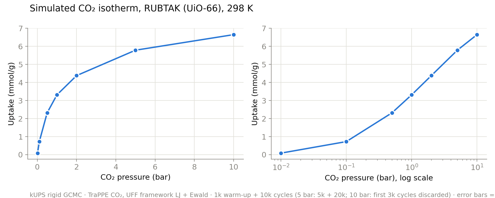

# CuspAI internship: MLFF distillation for GCMC

*Luv Suneja*

I spent six years building production ML systems in logistics. This year I've been studying geometric deep learning full time: I worked through the foundational texts and 16 papers, and implemented MACE, EGNN and Riemannian Flow Matching from the papers. This internship is exactly where I want to be: contributing to AI for science and transitioning into a research engineer position.

To prepare, I read the [kUPS article](https://medium.com/@CuspAI/kups-a-molecular-simulation-engine-for-the-ai-era-b213963a2359) and [handbook](https://cusp-ai-oss.github.io/kUPS/handbook/), then ran your [rigid GCMC example](https://github.com/cusp-ai-oss/kUPS/blob/3af6439/examples/mcmc_rigid.yaml) on my laptop to build a [CO₂ isotherm in UiO-66 from 0.01 to 10 bar](#appendix-co2-isotherm-in-uio-66).

Below is how I'd approach the project.

**Contents**

- [1. The JD](#1-the-jd)
- [2. Why](#2-why)
- [3. Aim](#3-aim)
- [4. Groundwork already done](#4-groundwork-already-done)
- [5. Ground truth](#5-ground-truth)
- [6. Benchmarks](#6-benchmarks)
- [7. Goals](#7-goals)
- [8. Background: candidate student models](#8-background-candidate-student-models)
- [9. Distillation method](#9-distillation-method)
- [10. Data and active learning](#10-data-and-active-learning)
- [11. Evaluation suite](#11-evaluation-suite)
- [12. Handover and production integration](#12-handover-and-production-integration)
- [13. Timeline](#13-timeline)
- [14. Risks, mitigations and blockers](#14-risks-mitigations-and-blockers)
- [Appendix: CO₂ isotherm in UiO-66](#appendix-co2-isotherm-in-uio-66)

## 1. The JD
- Distil state-of-the-art equivariant MLFFs into fast "student" potentials for GCMC screening of MOFs
- Integrate them into kUPS
- Validate against classical force fields: accuracy, throughput, failure modes
- Curate datasets and active-learning loops
- Profile the MC inner loop
- Contribute to a publication on MLFF-driven GCMC

## 2. Why
- **Problem:** better carbon capture needs better MOFs, and predicting their CO₂ uptake is a GCMC problem: millions of MC moves per isotherm.
- **Gap:** classical force fields are fast but miss the chemistry that matters (open metal sites, amines). ML potentials like MACE get much closer to DFT accuracy, but their inference cost dominates the GCMC inner loop.

## 3. Aim
A distilled student, accurate enough for guest–host interactions and with GCMC throughput within N× of classical force fields (N set in Goals), gives CuspAI ML-accuracy screening at near-classical speed.

## 4. Groundwork already done
- **kUPS article:** read end to end. What stood out: many simulations batched into one set of columnar tables, and each simulation step compiled into a single executable, so whole batches of systems run in parallel on one GPU.
- **Repo:** worked through the handbook and the Monte Carlo moves notebook, then traced the rigid GCMC app (`mcmc_rigid.py`) from config to output, to see how GCMC is built on Markov-chain Monte Carlo in kUPS.
- **BLIPs paper:** read [Bayesian Learned Interatomic Potentials](https://arxiv.org/abs/2508.14022) (Coscia, de Haan, Welling). It gives cheap, calibrated uncertainty for MLIPs by injecting learned noise into message-passing weights, and in my reading it fits an invariant one-round student, which is relevant to active learning here.
- **Hands-on:** ran the GCMC example and extended it to a **CO₂ isotherm in UiO-66**, 0.01–10 bar at 298 K ([plot in the appendix](#appendix-co2-isotherm-in-uio-66)).

## 5. Ground truth
**DFT is the ground truth.** The exact DFT setup for MOF + guest systems (functional, dispersion correction) is a choice I'd settle with the chemistry team.

**A fine-tuned MACE is its practical stand-in.** DFT is too expensive to label every training configuration, so a MACE teacher, fine-tuned on a targeted DFT set, labels the student's data.
- **Teacher active learning picks what DFT labels:** fine-tune a few MACE copies (different seeds) on a small random DFT seed, run them on candidate configurations from classical GCMC, and send the ones where they disagree most to DFT. Repeat.
- **Calibration:** random calibration and test sets of GCMC-visited configurations, fixed before training. Calibrated uncertainty is what makes stopping, trusting labels and flagging possible.
- **Minimal version:** a foundation MACE used as is, with its error measured on a small DFT set.
- **Open question:** can BLIP be made equivariance-safe for MACE (noise per irrep channel, or only in invariant layers)?

## 6. Benchmarks
The student has to land between two reference points, so I'd start by establishing both.

- **Throughput ceiling:** classical force fields, the fastest option. From my isotherm runs on an M1 CPU I estimate roughly 1,000 MC moves/s, i.e. about 1 ms per move; I'd re-measure this properly, on GPU too, before relying on it.
- **Accuracy ceiling:** the teacher (MACE) against DFT. Since the student learns from the teacher, I'd expect the teacher's error to set the student's floor.
- **Room between them:** I'd also measure how far classical GCMC sits from the teacher on these MOFs, since that is the gap the student can close.

## 7. Goals
*Illustrative; to be agreed with the chemistry team.*

- **Throughput:** no worse than N× slower than classical, with N between 2 (ambitious) and 10 (minimal). Classical baseline: see Benchmarks.
- **Accuracy:** uptake within X% of teacher-driven GCMC, with X between 5% (ambitious) and 10% (minimal).

## 8. Background: candidate student models
Candidates are compared on accuracy and cost per move. The link between them is reach: the farther a model sees around each atom, the more accurate it can be, but the more atoms must be recomputed after a move.

| Student | Accuracy | Cost per move |
|---|---|---|
| **Invariant MPNN, one round** (SchNet-style) | lowest: distances only | lowest |
| **Linear (ACE-style)** | low to medium | very low |
| **Equivariant, no irreps** (EGNN-style) | medium | low |
| **Equivariant, full** (MACE / NequIP-style, shrunk) | highest | highest |

*Expectations from architecture, not measurements; to be checked, on GPU as well as CPU.*

## 9. Distillation method
- **Teacher labels (main route):** train the student on teacher-labelled configurations to match energies, with forces as an extra signal.
- **Richer targets (fallback):** angle relations, internal features or Hessians.
- **Compress MACE first:** structured pruning and lower precision, checked against the N× throughput target. A new student only if that falls short.

## 10. Data and active learning
The student trains on guest–host configurations (guests placed in the MOF pores), each labelled with the teacher's energy and forces.

- **Round 0:** configurations from classical GCMC snapshots, plus random placements and close contacts, labelled by the teacher. Classical sampling is biased toward where the classical energy likes the guest to sit.
- **Student active learning rounds:** run GCMC with the current student, pick the snapshots where its uncertainty is highest, label them with the teacher, and retrain. For an invariant student, BLIP can supply that uncertainty cheaply.
- **Teacher-driven runs:** a few short runs for unbiased snapshots, as far as the teacher's cost per move allows (to be measured).

## 11. Evaluation suite
- **Potential level:** how close the student's energies and forces are to the teacher's (and the teacher's to DFT).
- **Simulation level:** how accurate the student's GCMC results are (uptake at each pressure), compared with teacher-driven GCMC, counting only differences larger than the Monte Carlo noise.
- **Why both:** a small force error can still shift uptake a lot, because uptake depends on energy through e^(−E/kT).
- **Failure modes:** where the student's error blows up, such as unfamiliar configurations or guest molecules.

**Plots:**
- **Isotherm overlay**, one panel per guest, with error bars: uptake vs pressure for the student candidates, teacher and classical force field.
- **Speed vs accuracy:** moves per second against uptake error, one point per student candidate.
- **Failure plot:** student candidates' error against distance from the training data, or against loading.
- **Parity plot:** student vs teacher energy, as a supporting check.

## 12. Handover and production integration
- **Integration:** the student plugs into kUPS's GCMC energy path, with cached incremental updates.
- **Profiling:** where time goes per move, and throughput against classical.
- **Tests and review:** regression tests, including student-driven GCMC reproducing a stored teacher isotherm, plus a speed benchmark.
- **Documentation:** user API and examples, and maintenance notes (dependencies, training recipe, versioned data).
- **Publication:** results for a paper on MLFF-driven GCMC.

## 13. Timeline
| Weeks | Work |
|---|---|
| **1–3** | Talk to the chemistry team; set up data generation and the GCMC environment; build the evaluation suite |
| **3–6** | Fine-tune MACE on DFT; start round 0 of student candidates on foundation-MACE labels |
| **5–9** | Student candidates, active-learning rounds and the compress-MACE alternative; filter candidates with the evaluation suite |
| **10–12** | Integration, documentation, tests, review and profiling |

## 14. Risks, mitigations and blockers
| Risk | Mitigation |
|---|---|
| **Wrong teacher:** MACE isn't fine-tuned well on DFT, so the student inherits its errors | Measure the teacher against held-out DFT before distilling; fall back to the foundation model with its error measured |
| **Student blind spots:** it fails outside its training data | Train on a wide range of configurations and loadings, and document the domain where it's reliable |
| **Wrong DFT settings** | Agree the setup with the chemistry and ML teams up front |
| **Data quality and timing** | Generate data at the start of the project, with experiments designed for quality |
| **Compute unknown** | Profile each experiment early to size the GPU needs |
| **Throughput target missed** | Try compressing MACE first; only then a shorter-reach student |
| **Student too narrow or too broad** | Start with one student per MOF family; widen only if it generalises |

## Appendix: CO₂ isotherm in UiO-66

Run with kUPS's rigid GCMC app on an M1 laptop (CPU): CO₂ (TraPPE) in RUBTAK = UiO-66 (UFF framework Lennard-Jones plus Ewald), 3×3×3 unit cells, 298.15 K.

| Pressure (bar) | CO₂ per unit cell | Uptake (mmol/g) |
|---|---|---|
| 0.01 | 0.144 ± 0.005 | 0.086 |
| 0.1 | 1.206 ± 0.024 | 0.725 |
| 0.5 | 3.859 ± 0.027 | 2.319 |
| 1 | 5.519 ± 0.034 | 3.317 |
| 2 | 7.290 ± 0.080 | 4.381 |
| 5 | 9.630 ± 0.091 | 5.787 |
| 10 | 11.065 ± 0.051 | 6.649 |

Each point: 1,000 warm-up and 10,000 production cycles. The 5 bar point was rerun with 5,000 warm-up and 20,000 production cycles, and at 10 bar the first 3,000 production cycles were discarded, because those runs were still equilibrating. Errors are block-average standard errors. This is a classical force-field result, not validated against experiment.
